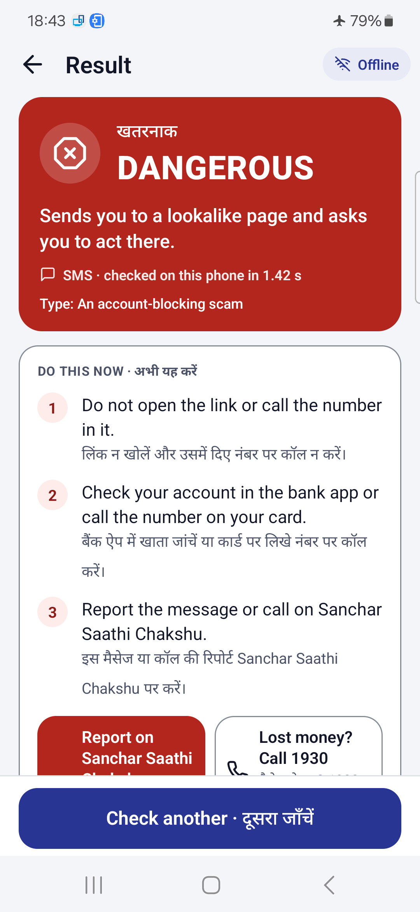

# Prahari

Prahari is an offline, on-device scam, phishing, and network-anomaly triage assistant built for the **Arm Bharat AI-SoC Challenge 2026–27 (PS3)** using **Llama 3.2 1B Instruct (INT4 QLoRA)** running through **ExecuTorch** on Arm CPUs. Small local detectors and Indian-context mechanism rules classify messages, URLs, and network events first; Llama 3.2 1B turns that structured evidence into plain-language explanations and safety guidance without cloud inference. Results are advisory and can be wrong. **Built with Llama** ([Llama 3.2 Community License](https://www.llama.com/llama3_2/license/)).

- **Final Phase 1 report:** [docs/phase1/report.pdf](docs/phase1/report.pdf) ([Markdown source](docs/phase1/report.md), reproducible build via `python3 docs/phase1/build_report.py`)
- **2-minute demo script:** [docs/phase1/demo-video.md](docs/phase1/demo-video.md)
- **Evidence ledger & Q&A:** [docs/phase1/EVIDENCE.md](docs/phase1/EVIDENCE.md) (raw logs in [docs/phase1/evidence/](docs/phase1/evidence/)) · [docs/phase1/LIMITATIONS.md](docs/phase1/LIMITATIONS.md) · [docs/phase1/RELEASE-AUDIT.md](docs/phase1/RELEASE-AUDIT.md)

## Physical Arm hardware & offline results

Prahari has been measured end to end on three Arm targets (all running the exact verified `Llama-3.2-1B-Instruct-QLORA_INT4_EO8.pte` via ExecuTorch XNNPACK):

| Target hardware | Runtime / setup | Warm TTFT | Decode speed | End-to-end / item | Memory | Offline proof |
|:--|:--|--:|--:|--:|--:|:--|
| **Samsung Galaxy S23 (`SM-S911B`)** (Snapdragon 8 Gen 2, `arm64-v8a`, Android 14, Samsung RTL) | ExecuTorch Android 1.5.1 XNNPACK, Chaquopy portable detectors | **510 ms** (499–510 ms warm; 657 ms airplane) | **43.4 tok/s** warm (39.0 tok/s airplane) | **1.20 s** warm (**1.42 s** airplane mode) | **1,745 MB PSS** / 1,867 MB RSS (`dumpsys meminfo`) | Airplane mode (`airplane_mode_on=1`) + `SecurityException` (no `INTERNET` permission) |
| **Arm Neoverse-V2 Linux** (8 online vCPUs, Debian 12, `i8mm` + `asimddp`) | ExecuTorch 1.6.0 XNNPACK, Python 3.12 (`perf` profiled) | **922 ms** (2T) / **527 ms** (8T) | **46.7 tok/s** (2T) / **104.6 tok/s** (8T) | **1.73 s** (2T) / **0.98 s** (8T) | **2,392 MiB** runner RSS | OS network namespace cut (`unshare -n`: HTTPS/DNS/TCP fail; 6/6 inference succeeds) |
| **Oracle Arm Neoverse-N1 VM** (2 vCPUs, Ubuntu 24.04, eval baseline) | ExecuTorch 1.6.0 XNNPACK, Python 3.12 | — | **19.9 tok/s** | **3.84 s** (eval range 3.8–4.8 s) | **2.05 GB** cgroup `memory.peak` | Evaluation import-time network guard |

- **KleidiAI kernel dispatch confirmed (`perf record -F 99 -g`, Neoverse-V2, 2 threads, 2,222 samples, 0 lost):** named `kai_*` leaf functions accounted for **54.17% of sampled whole-process CPU time**, led by `kai_kernel_matmul_clamp_f32_qai8dxp4x8_qsi4c32p4x8_16x4x32_opt32_neon_i8mm` (**23.27%**, prefill) and `kai_kernel_matmul_clamp_f32_qai8dxp1x8_qsi4c32p4x8_1x4x32_neon_dotprod` (**20.57%**, token decode), traced through `xnn_invoke_runtime` to ExecuTorch's XNNPACK delegate.

## Detection & explanation results (honest summary)

Both holdout benchmarks are reported directly so the current false-alarm trade-off is transparent:

- **Independent India dev set v3 — held-back split (PR #42, `n = 81`, unseen during tuning):** conservative F1 improved **0.761 → 0.889**, recall **0.794 → 0.941**, false positive rate **0.213 → 0.128**.
- **Sealed final holdout (`n = 184`: 155 SMS-route, 29 injection-route; now scored multiple times):** combined F1 **0.784**, recall **0.929**, combined FPR **0.37**, **SMS-route FPR 0.402** (35/87 benign SMS flagged; injection FPR 0.154). Prior `gen51` scored F1 0.802 / combined FPR 0.31; PR #21 baseline scored F1 0.709 / FPR 0.29. Many sealed-holdout false positives stem from placeholder `.example` URLs and benign safety advisories quoting scam vocabulary — reducing genuine-notice false alarms without hurting recall is active work prior to final freeze.
- **Repeatedly used project evaluation sets (Oracle, post-PR #42):** SMS F1 **0.925** (`n = 1,162`), URL F1 **0.994** (`n = 7,997`, FPR 0%), Indic F1 **0.969** (`n = 320`, FPR 3.1%), NSL-KDD flow replay F1 **0.850** (`n = 22,544`, FPR 3.03%). Reviewer adversarial suite: **22/24** scams caught, **5/13** harmless flagged. India v2 adaptive validation: **0.839**.
- **Explanation quality (PR #41):** After blind manual audits (20-item holdout audit: 5 correct, 8 weak, 7 wrong; plus 40-item shuffled audit and S23 inspection), PR #41 removed repeated openings, false absence assertions on `NO RISK` verdicts, and stray generated questions. Automated proxy explanation score rose **0.929 → 0.932**, consistency v2 **0.929 → 0.964**, grounding **27/28** (a fresh post-PR #41 manual audit remains pending).

## Android app

The app in [`android/`](android/) declares **no `INTERNET` permission** and runs portable NumPy/JSON detectors (exported from scikit-learn with zero cross-version unpickling) plus Llama 3.2 1B through ExecuTorch Android XNNPACK.

- **Physical Galaxy S23 (`SM-S911B`, `arm64-v8a`) verification:** ran the r1 APK end to end across KYC scam SMS, bank debit alert, lookalike URL, port scan, airplane mode (`1.42 s`), and the Android `SecurityException` permission test (`12 ms`).
- **Round-2 UX additions on `main` (PR #43, verified on Android 14 x86_64 emulator, pending S23 re-test):** Android Share-sheet intake (`ACTION_SEND`, `ACTION_PROCESS_TEXT`), full `EN | हिंदी` UI/steps/evidence toggle (Llama prose remains English with explicit note), offline `Listen / सुनें` text-to-speech of vetted verdict and steps, quoted non-clickable evidence spans with defanged links and masked OTPs, safety-filter replacement badge, opt-in redacted local history (off by default), and an on-device pure-Python QR photo decoder (no camera/storage permission).

For APK setup and model staging on a physical phone, see [android/README.md](android/README.md#remote-phone-checklist).

| Physical Galaxy S23 in Airplane Mode (`✈`) | On-device Arm64 ExecuTorch Stats (`43.4 t/s`) | OS Offline Permission Proof (`SecurityException`) |
| :---: | :---: | :---: |
|  |  |  |

## Run on aarch64 Linux

Use Python 3.12 (see [`candidates/BEST/requirements.txt`](candidates/BEST/requirements.txt)). Network access is required only once for package installation and model download, never for inference.

```sh
python3.12 -m venv .venv
. .venv/bin/activate
pip install -r candidates/BEST/requirements.txt
pip install 'huggingface_hub[cli]'
```

Visit the [ExecuTorch-community Llama 3.2 1B QLoRA model page](https://huggingface.co/executorch-community/Llama-3.2-1B-Instruct-QLORA_INT4_EO8-ET), request access, and accept the [Llama 3.2 Community License](https://www.llama.com/llama3_2/license/) and [Acceptable Use Policy](https://www.llama.com/llama3_2/use-policy/). Authenticate locally with the Hugging Face CLI (never commit tokens), download the `.pte` and tokenizer, and verify SHA-256 digests:

```sh
hf download executorch-community/Llama-3.2-1B-Instruct-QLORA_INT4_EO8-ET --local-dir "$PWD/.venv/models/qlora"
sha256sum .venv/models/qlora/Llama-3.2-1B-Instruct-QLORA_INT4_EO8.pte .venv/models/qlora/tokenizer.model
```

- `Llama-3.2-1B-Instruct-QLORA_INT4_EO8.pte` SHA-256: `ab7b7ebf97421c7770ad97d4abfdf8650a7d9f9dc1ce9a0c4663d49f7b7a08ac`
- `tokenizer.model` SHA-256: `82e9d31979e92ab929cd544440f129d9ecd797b69e327f80f17e1c50d5551b55`

Upstream files can change; stop if either hash differs. On a fresh Debian 12 Arm box (the Neoverse-V2 run) two extra steps were needed: `apt install libatomic1`, and replacing the default Torch wheel with the matching CPU-only wheel.

Create a local registry pointing to those files (keeping the tracked `models/registry.json` untouched):

```sh
python - <<'PY'
import json
from pathlib import Path
r = json.loads(Path('models/registry.json').read_text())
p = Path('.venv/models/qlora').resolve()
r['llama32-1b-qlora']['pte'] = str(p / 'Llama-3.2-1B-Instruct-QLORA_INT4_EO8.pte')
r['llama32-1b-qlora']['tokenizer'] = str(p / 'tokenizer.model')
Path('.venv/prahari-registry.json').write_text(json.dumps(r, indent=2))
PY
export HC_PY="$PWD/.venv/bin/python" HC_MODEL_REGISTRY="$PWD/.venv/prahari-registry.json"
```

Run Prahari on Linux:

```sh
candidates/BEST/bin/app --selftest                     # fast detector smoke test
candidates/BEST/bin/app --demo --out .venv/demo.json   # 6-item CLI demo with Llama 3.2 explanations + timings
candidates/BEST/bin/app --port 8765                    # local web UI on http://127.0.0.1:8765
```

### Rootless Linux live connection monitor (PR #40)

On Linux, `candidates/BEST/bin/monitor` samples `/proc/net/tcp`, `/proc/net/tcp6`, and `/proc/net/snmp` every 0.5 s without root or packet capture, summarises anomalies (port scans, login-port repeats, half-open socket bursts, periodic connections, failed-connect/reset surges), and feeds the summary through the flow rules (and optionally `--explain` via Llama 3.2). NSL-KDD 41-feature records are scored separately as dataset replay via `bin/predict --task flow`.

```sh
python3 candidates/BEST/bin/scan_demo.py --open --ports 150 &
candidates/BEST/bin/monitor --seconds 6                # add --explain for local Llama guidance
```

## Build the final report PDF

The PDF at [`docs/phase1/report.pdf`](docs/phase1/report.pdf) is built reproducibly (charts + XeLaTeX layout, verified `< 10 MB`) via:

```sh
python3 docs/phase1/build_report.py
```

## Call Guard (preview)

`candidates/BEST/bin/callguard` checks a shared voice note or a recording made with consent for the Indian "digital arrest" call script. It transcribes the audio on the device with Arm's INT8 Whisper Tiny through ExecuTorch, applies the existing detector plus call-script rules, and has Llama 3.2 1B write a STOP warning, alongside vetted steps that name 1930 and Sanchar Saathi Chakshu. On the Neoverse-N1 VM, speech-to-text ran 2.7–4.8x faster than real time, and peak RSS was 832 MiB for ASR alone and 2,611 MiB with Llama. Apps cannot tap live call audio. Hindi is not reliable, and the Android hook has not run on a phone. Details, measurements and limits: [docs/call-guard.md](docs/call-guard.md).

## Repository map

- **Phase 1 submission package:** [report.pdf](docs/phase1/report.pdf), [report.md](docs/phase1/report.md), [EVIDENCE.md](docs/phase1/EVIDENCE.md), [LIMITATIONS.md](docs/phase1/LIMITATIONS.md), [demo-video.md](docs/phase1/demo-video.md), [SUBMISSION.md](docs/phase1/SUBMISSION.md), [RELEASE-AUDIT.md](docs/phase1/RELEASE-AUDIT.md), [build_report.py](docs/phase1/build_report.py).
- **Application & Android port:** [candidates/BEST/](candidates/BEST/) (detectors, rules, Llama runner, live monitor, web UI, tests) · [android/](android/) (Kotlin + Chaquopy + ExecuTorch Android app).
- **Provenance & benchmarks:** [candidates/BEST/DATA.md](candidates/BEST/DATA.md) · [bench/README.md](bench/README.md) · [research/stress/README.md](research/stress/README.md) · [docs/challenge-brief.md](docs/challenge-brief.md).

## Licences and credits

- **Built with Llama:** Llama 3.2 1B Instruct weights are obtained separately from Hugging Face and governed by Meta's [Llama 3.2 Community License](https://www.llama.com/llama3_2/license/) and [Acceptable Use Policy](https://www.llama.com/llama3_2/use-policy/). No weights or tokenizers are committed to this repository.
- **Datasets:** All training/evaluation datasets are separately acquired and documented in [candidates/BEST/DATA.md](candidates/BEST/DATA.md): UCI SMS Spam Collection (Almeida et al., 2011; CC BY 4.0), Mendeley SMS Phishing Dataset (Mishra & Soni, 2022; CC BY 4.0), PhiUSIIL Phishing URL Dataset (Prasad & Chandra, 2024; CC BY 4.0), NSL-KDD (Tavallaee et al., 2009; UNB research use, not redistributed), `karanverma19/Indian_Multilingual_Scam_Message_Dataset` (Apache-2.0), `bolewara/hinglish-scam-text-dataset` (CC BY 4.0), and original project-generated Indian-context synthetic sets.
- **Upstream frameworks:** ExecuTorch and PyTorch (BSD-3-Clause), Arm KleidiAI (Apache-2.0), Chaquopy (MIT), scikit-learn / NumPy / SciPy / pandas / joblib (BSD-3-Clause), Kotlin / Android Gradle Plugin (Apache-2.0). The Android QR decoder (`android/python/qrdec.py`) is original pure-Python project code.
- **Project licence:** No root open-source `LICENSE` file has been added yet; check with the repository owner before reusing project source or artifacts (see [RELEASE-AUDIT.md](docs/phase1/RELEASE-AUDIT.md)).
