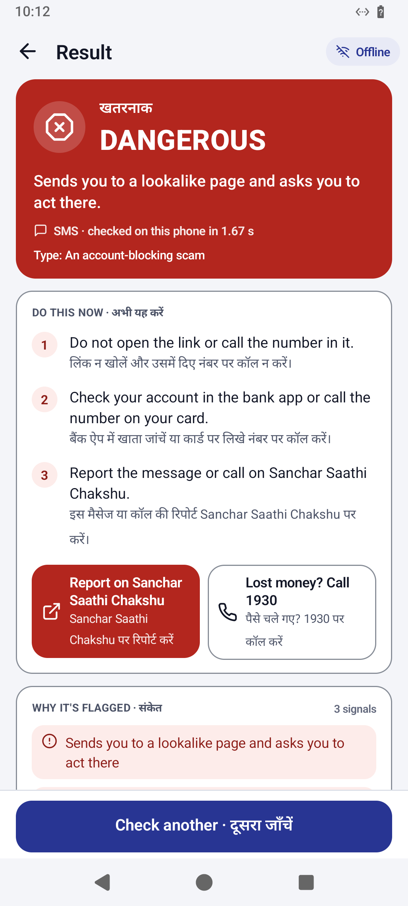

# Prahari

Prahari is a prototype offline scam and phishing triage assistant for Arm Bharat AI-SoC Challenge 2026–27, PS3. Local detectors classify pasted messages and URLs; Llama 3.2 1B generates advice through ExecuTorch. A network text description is scored by rules; a separate trained model scores NSL-KDD feature records as dataset replay. Live traffic capture is not implemented. Results are advisory and can be wrong. Built with Llama (Llama 3.2 Community License). Arm measurements are from a cloud VM; Android has also been run on an x86_64 emulator, not a physical phone.

## Round-3 results

On Oracle's two-vCPU Arm Neoverse-N1 VM, the shipped version (content hash `1e08f778…`, gen51 plus later rule and advice changes) achieved conservative F1 of 0.922 on SMS, 0.994 on URL, 0.950 on Indic and 0.850 on NSL-KDD flow replay. These hidden sets were used repeatedly during development. On the separately sealed final holdout, gen51 scored combined F1 0.802 and FPR 0.31 (the later fixes were not re-scored); hard benign look-alikes caused many false alarms. In the PR #30 evaluation (`b9e16a6e…`), end-to-end processing took about 3.8 s/item and peak cgroup memory was 2.05 GB (systemd scope `memory.peak`, including page cache; not process RSS). See the [report](docs/phase1/report.md) for the baseline, evaluation limits and explanation audit. No real-phone result has been measured.

## Android app

The app in `android/` ran the shipped detector and Llama 3.2 1B end to end on an Android 14 x86_64 emulator. It shows vetted steps before the AI explanation and declares no `INTERNET` permission. Emulator timings are not Arm timings; a physical-phone Llama run remains untested. For setup and pushing the separately obtained model and tokenizer, see [android/README.md](android/README.md#remote-phone-checklist).



## Run on aarch64 Linux

Use Python 3.12 and sufficient storage and RAM. The tested environment is described in [the report](docs/phase1/report.md); exact dependency availability on a fresh machine remains to be verified. Network access is needed for installation and model acquisition, not intended for inference.

```sh
python3.12 -m venv .venv
. .venv/bin/activate
pip install -r candidates/BEST/requirements.txt
pip install 'huggingface_hub[cli]'
```

Visit the [ExecuTorch-community Llama 3.2 1B QLoRA model page](https://huggingface.co/executorch-community/Llama-3.2-1B-Instruct-QLORA_INT4_EO8-ET), request access and accept the Llama 3.2 Community License and applicable terms. Authenticate with the Hugging Face CLI using your own access; do not commit credentials. Then acquire the PTE and tokenizer from that repository and verify the files against the following hashes, observed on oracle-a1 on 17 November 2026:

```sh
hf download executorch-community/Llama-3.2-1B-Instruct-QLORA_INT4_EO8-ET --local-dir "$PWD/.venv/models/qlora"
sha256sum .venv/models/qlora/Llama-3.2-1B-Instruct-QLORA_INT4_EO8.pte .venv/models/qlora/tokenizer.model
```

- PTE: `ab7b7ebf97421c7770ad97d4abfdf8650a7d9f9dc1ce9a0c4663d49f7b7a08ac`
- Tokenizer: `82e9d31979e92ab929cd544440f129d9ecd797b69e327f80f17e1c50d5551b55`

Upstream files can change; stop if either hash differs and resolve the version before running. The committed registry contains paths specific to the measurement host. Create a local registry without modifying the tracked one:

```sh
python - <<'PY'
import json
from pathlib import Path
r = json.loads(Path('models/registry.json').read_text())
p = Path('.venv/models/qlora').resolve()
r['llama32-1b-qlora']['pte'] = str(p / 'Llama-3.2-1B-Instruct-QLORA_INT4_EO8.pte')
r['llama32-1b-qlora']['tokenizer'] = str(p / 'tokenizer.model')
Path('.venv/prahari-registry.json').write_text(json.dumps(r, indent=2))
PY
export HC_PY="$PWD/.venv/bin/python" HC_MODEL_REGISTRY="$PWD/.venv/prahari-registry.json"
```

One-command demonstration after setup:

```sh
candidates/BEST/bin/app --demo --out .venv/demo-output.json
```

The demo generates explanations and reports latency and process peak RSS. `candidates/BEST/bin/app --selftest` checks detectors; `candidates/BEST/bin/app --port 8765` serves the UI on loopback. See the [demo script](docs/phase1/demo-script.md) for an offline proof and the separation between network paths. Normal execution does not itself enforce an egress block.

## Call Guard (preview)

`candidates/BEST/bin/callguard` checks a shared voice note or a recording made with consent for the Indian "digital arrest" call script. It transcribes the audio on the device with Arm's INT8 Whisper Tiny through ExecuTorch, applies the existing detector plus call-script rules, and has Llama 3.2 1B write a STOP warning that names 1930 and Sanchar Saathi Chakshu. On the Neoverse-N1 VM, speech-to-text ran 2.1–4.5x faster than real time, and peak RSS was 851 MB for ASR alone and 2.67 GB with Llama. Apps cannot tap live call audio. Hindi is not reliable, and the Android hook has not run on a phone. Details, measurements and limits: [docs/call-guard.md](docs/call-guard.md).

## Repository map

- [Technical report](docs/phase1/report.md), [evidence ledger](docs/phase1/EVIDENCE.md), [jury Q&A](docs/phase1/LIMITATIONS.md) and [shot list](docs/phase1/demo-script.md).
- [Application and detectors](candidates/BEST/); [data and model provenance](candidates/BEST/DATA.md); [visible benchmark](bench/README.md); [stress tests](research/stress/README.md).
- [Challenge brief snapshot](docs/challenge-brief.md) and historical [research](research/).

## Licences and credits

Third-party data and model sources and their stated licences are listed in [DATA.md](candidates/BEST/DATA.md). Llama weights and datasets are separately obtained and subject to their own terms. The repository currently has no identified project licence grant; obtain the owner's permission before reusing project code or artifacts. Prahari uses Python, scikit-learn, PyTorch and ExecuTorch; their respective upstream licences apply. Arm, Meta, the dataset authors and other upstream contributors retain their rights.

To render the submission PDF locally (the PDF is ignored by Git and attached at submission):

```sh
pandoc docs/phase1/report.md -o docs/phase1/report.pdf --pdf-engine=xelatex --resource-path=docs/phase1:.
```
