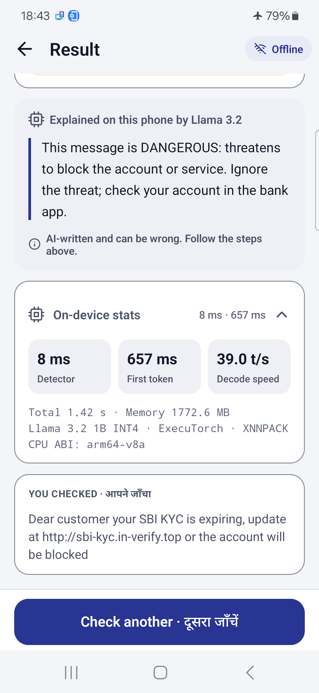
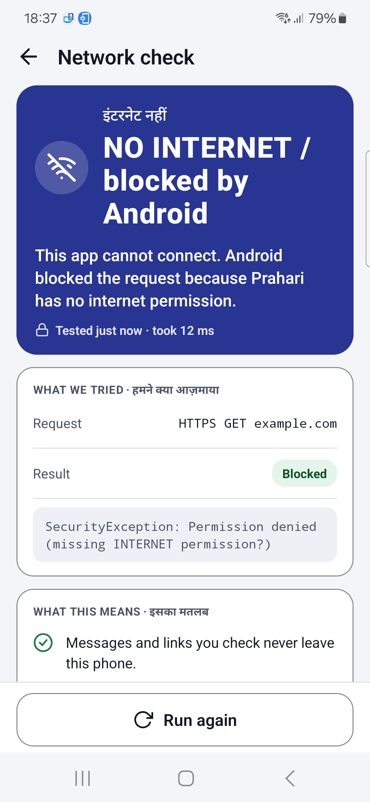

## Executive Summary

Prahari is an offline, on-device cybersecurity triage assistant built for Indian smartphone and Arm Linux users under **Problem Statement 3 (PS3)** of the Arm Bharat AI-SoC Challenge 2026–27 [S1]. It classifies suspicious SMS/WhatsApp-style messages, phishing URLs, prompt-injection attempts, and network events locally using compact classical models and transparent Indian-context mechanism rules, then uses **Llama 3.2 1B Instruct (INT4 QLoRA)** running through **ExecuTorch XNNPACK** on the Arm CPU to explain the structured evidence in plain language alongside vetted safety steps [S2, S9, S10]. Prahari is strictly advisory: it never opens links, modifies accounts, or sends user content to a cloud service. **Built with Llama.**

| Dimension | Verified Phase 1 Measurement (`main` `28bdb6b`, 24 Nov 2026) | Evidence & Qualification |
|:--|:--|:--|
| **Physical Arm Smartphone** | **Samsung Galaxy S23 (`SM-S911B`, Snapdragon 8 Gen 2, `arm64-v8a`)**: warm TTFT **510 ms** (499–510 ms), decode **43.4 tok/s**, total **1.20 s/check** (**1.42 s** in Airplane Mode `airplane_mode_on=1`), **1.66 GiB PSS** / 1.78 GiB RSS (`dumpsys`) | Real handset via Samsung Remote Test Lab (r1 APK; PR #43 r2 UI verified on Android 14 emulator, awaiting S23 re-test) [S9, S11] |
| **Arm Linux & KleidiAI** | **Arm Neoverse-V2 (8 vCPU)**: **54.17%** of sampled CPU time inside **Arm KleidiAI** `kai_*` kernels (`perf`: 23.27% `i8mm` prefill, 20.57% `dotprod` decode); **1.73 s/item** at 2T (46.7 tok/s), **0.98 s/item** at 8T (**104.6 tok/s**) | `perf record -F 99 -g` (2,222 samples, 0 lost); `unshare -n` OS network-cut proof passed 6/6 [S10] |
| **Offline Privacy** | Android app declares **no `INTERNET` permission** (`SecurityException` in 12 ms on S23) + ran in **Airplane Mode**; Linux verified under `unshare -n` (`lo` down; HTTPS/DNS/TCP fail, inference passes) | Model download/staging is one-time before offline use; external dialler/browser open separate apps [S9, S10] |
| **Detection (Holdouts)** | **India v3 held-back (`n = 81`)**: F1 **0.970**, recall **0.941**, FPR **0.000** (0.889 / 0.128 after PR #42). **Sealed final holdout (`n = 184`)**: combined F1 **0.813**, recall **0.929**, combined FPR **0.300**, **SMS FPR 0.322** (was 0.402 before PR #48). **New blind validation set (`n = 240`)**: FPR **0.120**, recall **1.000** | Both holdouts reported; remaining sealed false alarms are mostly advisories with placeholder `.example` links and family scam-warning chats [S8, S11, S12] |
| **Detection (Dev/Eval Sets)** | SMS F1 **0.925** (`n=1,162`), URL F1 **0.994** (`n=7,997`), Indic F1 **0.969** (`n=320`, FPR 3.1%), NSL-KDD flow replay F1 **0.850** (`n=22,544`); adversarial suite **22/24** caught, **5/13** harmless flagged | Repeatedly used development sets on Oracle Neoverse-N1 VM, last `bin/eval` after PR #42; conservative metrics (`uncertain` = error) [S8, S11] |
| **Network Monitoring** | Rootless Linux live connection monitor (`bin/monitor` reading `/proc/net/tcp{,6}` + `/proc/net/snmp`) catches live loopback port scans; separate NSL-KDD tree replays 41-feature records | Socket-table + kernel-counter sampling on Linux (no root, no raw packet capture; Linux only) [S11] |

## Problem Statement and Indian Threat Context

Indian smartphone users routinely encounter fraudulent SMS and messaging pretexts built around familiar domestic rails: UPI collect requests disguised as refunds, fake KYC or PAN/Aadhaar suspension warnings, electricity-disconnection threats, courier/customs fees, task-recharge scams, and "digital arrest" impersonation of police or regulators. The Ministry of Home Affairs has publicly warned about fake digital arrests and courier impersonation ([PIB, 2024](https://www.pib.gov.in/PressReleasePage.aspx?PRID=2077948)). NCRB recorded **101,928 registered cybercrime cases in 2024**, and separately I4C reported **more than 6,589,201 financial-fraud complaints** totalling **over Rs 55,050 crore** on the national portal across 2021–2025 ([PIB, 2026](https://www.pib.gov.in/PressReleasePage.aspx?PRID=2287039)). (Registered cases and portal complaints are distinct measures and do not quantify Prahari's target user base.)

Genuine bank debit alerts, OTP notifications, bill reminders, and telecom advisories share almost the exact same vocabulary ("OTP", "Rs", "UPI", "account", "KYC", "blocked") across English, Devanagari Hindi, and Romanised Hinglish. A naïve keyword or cloud-LLM wrapper either sends private banking texts off-device or flags legitimate bank alerts constantly, driving users to ignore or uninstall the tool. Following the PS3 brief and mentor guidance, Prahari therefore keeps all inference strictly local on Arm hardware, separates deterministic detection from **Llama 3.2 1B / ExecuTorch** explanation, and distinguishes *what a sender asks the recipient to do* from benign informational notices [S1, S2].

\newpage

## Methodology

### Hybrid Two-Stage Architecture

Prahari separates **verdict + evidence extraction** (Stage 1: 0.42 ms/item on Arm Linux; 5–17 ms warm for text checks on Galaxy S23, 183 ms for a URL) from **plain-language explanation** (Stage 2, Llama 3.2 1B via ExecuTorch). The language model never decides the verdict and never chooses critical helpline actions; instead, it explains the detector's typed evidence so a hallucination or prompt injection in an untrusted message cannot flip a dangerous item into "safe" [S2, S8].

```text
+-------------------------------+     +------------------------------------------+
| Pasted/shared SMS, URL, or QR | --> | Stage 1: Trained classifiers + Indian    |
| (Android app / Linux CLI/UI)  |     | mechanism rules + verdict/evidence fusion|
+-------------------------------+     +--------------------+---------------------+
                                                           |
+-------------------------------+                          v  verdict + typed evidence
| Linux live socket monitor     | --> Flow text rules ---->+  + vetted India actions
| (/proc/net/tcp,tcp6,snmp)     |                          |
+-------------------------------+                          v
                                               +-------------------------------+
                                               | Stage 2: Llama 3.2 1B (INT4)  |
                                               | via ExecuTorch XNNPACK on Arm |
                                               | + honesty & safety post-check |
                                               +-------------------------------+

+-------------------------------+     +------------------------------------------+
| NSL-KDD 41-feature record     | --> | HistGradientBoosting + 3 intrusion rules |
| (bin/predict --task flow)     |     | (separate dataset replay path)           |
+-------------------------------+     +------------------------------------------+
```

### Stage 1: Detectors and Indian-Context Mechanism Layer

1. **Compact local classifiers (`candidates/BEST/train.py`, scikit-learn):**
   - **SMS model:** word/char TF-IDF + Logistic Regression trained on English SMS corpora.
   - **URL model:** character n-gram TF-IDF + Logistic Regression plus lexical indicators (punycode/homoglyph digit swaps, lookalike brand imitation on disposable TLDs such as `.top`/`.xyz`, missing HTTPS, IP hosts, excessive subdomains). URLs are never fetched.
   - **Indian-context model:** character and word n-grams combined with a **19-dimension mechanism feature vector** in Logistic Regression so unseen Hindi/Hinglish spellings still activate shared cues.
   - **NSL-KDD flow model:** Histogram Gradient-Boosted Decision Tree over NSL-KDD's 41 named flow features, augmented with three high-precision intrusion signatures (failed-login bursts, malformed fragments, same-source/destination loops) that trigger on 0.10% (75/74,112) of normal train+dev records [S2, S4].
2. **Transparent mechanism layer (`triage/mech.py`, `triage/rules.py`, updated in PR #42):**
   - Normalises zero-width characters, full-width Unicode forms, and spaced capitals before matching.
   - Separates **harmful mechanics** (requesting OTP/PIN/CVV/card details, demanding payment to a personal number/UPI ID/"safe" account or lookalike domain, pushing a UPI collect request, installing a screen-sharing/APK remote-access app, digital-arrest/authority coercion, upfront job/loan/customs/prize fees, sending ID papers to a chat/link) from **benign mechanics** (completed receipts, OTP notifications, routine bills/appointments without an unofficial contact, official app/portal pointers, protective disclaimers such as "we never ask for OTP", opt-out promos).
   - **Asymmetric safety precedence:** a decisive harmful mechanic overrides a protective disclaimer (scammers routinely write *"no OTP needed, pay Rs 499 fee"*); conversely, PR #42 tightened rules so contacts count only when an action names them, toll-free numbers are distinguished from personal mobiles, and advisories without a spoofed contact are cleared [S11].
   - **Cautious `SUSPICIOUS` policy for bank/OTP alerts:** genuine-looking bank debit alerts that advise blocking the card in the bank app are rendered as **SUSPICIOUS (check alert)** rather than screaming scam, instructing *"Didn't make this payment? Call 1930 and block the card or UPI in your bank app"* [S7, S8].
   - **Prompt-injection defence:** untrusted text is scanned by a dedicated injection pattern route (`classify_any("injection", text)`) and always framed as quoted data inside the Llama prompt [S2].

### Stage 2: Grounded Llama 3.2 1B Advisory Layer and Honesty Guards

Stage 2 invokes **Llama 3.2 1B Instruct (`llama32-1b-qlora`)** through ExecuTorch's `TextLLMRunner` (Python Linux) and `LlmModule` (Android JNI) [S2, S7]. The prompt supplies the authoritative verdict, short scam category, and compressed evidence phrase, neutralises live URLs, and forces a verdict-first sentence followed by one concise protective step. Fixed India-specific vetted steps are always displayed **above** the AI card: **Sanchar Saathi Chakshu** is primary for scam messages/links before monetary loss, **1930** is primary when money has already been debited, and **cybercrime.gov.in** is surfaced for extortion/sextortion [S7].

Following blind manual audits and the physical Galaxy S23 run, **PR #41** added deterministic explanation-honesty post-checks (`triage/llm.py`):

- Neutral `NO RISK FOUND` openings only assert absence of elements actually absent from the text (no false "no link" claim when an official link is present).
- `NO RISK FOUND` outputs and evidence chips never cite an overruled risk signal on any route.
- Repeated sentences (observed on the S23 r1 bank-debit run) are deduplicated.
- Generated questions (such as *"Can I help you with something else?"*, observed on S23 r1) are stripped or replaced on risky items by the scam-type's vetted step, alongside earlier filters replacing compliance-urging or disruptive network advice [S8, S11].

**PR #50** (`e0adb82`) then grounded the second sentence and added a validator [S12]:

- **Grounded key fact:** the prompt now carries one vetted, advice-led fact per scam type or benign reading (`llm.key_fact`), and Llama writes its own sentence from it instead of filling an empty "advice" slot with stock lines.
- **Honesty validator** (`llm.validate`): a generated sentence is dropped if it claims a link, number, device or domain the item lacks, makes an unsupported OTP/payment/app/KYC claim, hedges against a `NO RISK` verdict, or is vague, first-person, overclaiming or mixed-script. The vetted fact replaces it; if no model text survives, the explanation is reported as failed rather than passed off as model output.
- **Hindi summary** (`triage/explain_hi.py`): a fixed-text Hindi summary built from the detector result, labelled as not AI-written and shown first in Hindi mode. The 1B model cannot write usable Hindi, so `explanation` stays Llama's English text.

### Applications: Android Offline App and Linux Rootless Live Monitor

- **Android offline app (`android/`):** Kotlin UI + Chaquopy 17.2.0 (Python 3.10 + NumPy 1.26.2) + ExecuTorch Android 1.5.1 AAR (with a CI source-build path for ExecuTorch 1.6.0). Declares **zero `INTERNET` permission** (`AndroidManifest.xml`, verified by CI `aapt` check) and sets `android:allowBackup="false"`. Round-2 features merged in **PR #43** (verified on Android 14 x86_64 emulator; pending S23 re-test) add Android Share-sheet intake (`ACTION_SEND`, `ACTION_PROCESS_TEXT`), full `EN / Hindi` UI/steps/evidence toggle (Llama prose remains English with explicit note), offline `Listen` TTS over vetted verdict/steps only, quoted non-clickable evidence spans with defanged URLs and masked OTPs, badged safety-filter replacements, opt-in redacted local history (off by default), and an on-device pure-Python ISO/IEC 18004 QR photo decoder (`android/python/qrdec.py`, zero camera/storage permission) [S7, S11].
- **Linux CLI, web UI, and rootless live connection monitor (`candidates/BEST/bin/`):** `bin/app --demo` runs a 6-item CLI benchmark; `bin/app --port 8765` serves a loopback-only web UI; **PR #40** added `bin/monitor` (`triage/live.py`), which samples `/proc/net/tcp`, `/proc/net/tcp6`, and `/proc/net/snmp` every 0.5 s without root or packet capture to flag port scans, repeated login-port connects, half-open floods, periodic beacons, and failed-connect/reset bursts, feeding descriptions into the flow rules and optional `--explain` Llama advisory. (`bin/scan_demo.py --open` provides harmless loopback test traffic.) Note that `bin/monitor` is Linux-only (Android 10+ restricts `/proc/net`) and is distinct from the NSL-KDD 41-feature dataset replay path (`bin/predict --task flow`) [S11].
- **UPI QR checker (PR #46 via #51, `28bdb6b`):** `triage/upi.py` parses `upi://pay`, `collect` and `mandate` links, app intent schemes (`tez://`, `phonepe://`, `intent://…scheme=upi`) and bare `pa=…` QR strings offline, and flags "scan to receive money" lures, collect requests and AutoPay mandates, payee-name vs UPI-ID mismatches (a bank or government name on a personal ID, lookalike handles), abnormal amounts, merchant-code anomalies, threatening notes and payload abuse. Its structured evidence feeds the same Llama explanation path; real-format merchant QRs (Paytm, PhonePe, BharatPe, IRCTC, utility BBPS and others) come back `NO RISK FOUND` in the tests. Wired into `bin/predict --task upi`, the Linux app and the Android intake [S12].
- **Call Guard preview (PR #49, `1df1278`, behind a flag):** for a shared voice note or a consented speakerphone recording, Arm's INT8 Whisper Tiny `.pte` (Apache-2.0, downloaded once, not committed) transcribes up to 2 minutes on the CPU through ExecuTorch/XNNPACK, digital-arrest call-script rules (`triage/callrules.py`) plus the SMS detector decide, and Llama writes a "STOP — This call is DANGEROUS" explanation. It is off unless `PRAHARI_CALL_GUARD=1`, is not in `bin/predict`/`bin/explain`, and its Android screen is compiled but not wired in. Whisper is a second neural model, so whether it fits the rules is an open question to the organisers (`research/QUESTIONS.md` item 9) [S12].

### Datasets, Splits, and Evaluation Protocol

| Dataset and Source | Stated Licence | Split and Sample Count (`n`) |
|:--|:--|:--|
| [UCI SMS Spam](https://archive.ics.uci.edu/dataset/228/sms+spam+collection) (Almeida et al., 2011) & [Mendeley SMS Phishing](https://data.mendeley.com/datasets/f45bkkt8pr) (Mishra & Soni, 2022) | CC BY 4.0 each | Combined SMS: train 4,127; dev 607; eval 1,162 (grouped by normalised text to prevent leakage) |
| [PhiUSIIL Phishing URLs](https://archive.ics.uci.edu/dataset/967) (Prasad & Chandra, 2024) | CC BY 4.0 | Train 40,000; dev 4,000; eval 7,997 (grouped by domain; balanced eval cap) |
| [NSL-KDD](https://www.unb.ca/cic/datasets/nsl.html) (Tavallaee et al., 2009) | Redistribution permitted with citation (UNB); not redistributed here | `KDDTrain+` train 113,273 / dev 12,700; `KDDTest+` eval 22,544 (distribution-shifted replay) |
| [karanverma19 Indian seed](https://huggingface.co/datasets/karanverma19/Indian_Multilingual_Scam_Message_Dataset) & [bolewara Hinglish seed](https://huggingface.co/datasets/bolewara/hinglish-scam-text-dataset) | Apache-2.0 & CC BY 4.0 | 136 combined seed rows in training |
| Project-generated Indian-context sets | Original project work | Visible train 256 / dev 64; eval 320; India v2 adaptive validation 400; India v3 tuning 159 / held-back 81; v4 tuning 161; sealed final holdout 184 (155 SMS + 29 injection); `fp_val_v1` 240 (PR #48; written blind by a delegate with no repo access, CC0) |

All headline detection numbers use **conservative metrics** where `uncertain` counts as an error on both classes (`coverage` reported separately). Project eval sets were used repeatedly during development; India v2 was aggregate-only adaptive validation; **both** the v3 held-back split (`n = 81`) and the independently authored sealed holdout (`n = 184`) are reported in full in Section 6 [S6, S8, S11].

## Optimization Techniques

Prahari targets interactive on-device response (`~1–2 s`) and bounded memory on CPU-only Arm SoCs through five concrete engineering choices:

1. **Detector-first cascade (keeping Llama off the classification hot path):** Classical classifiers and mechanism rules execute in **0.42 ms/item** on Arm Linux and **5–17 ms** warm for text checks on Galaxy S23 (183 ms for the lookalike-URL check, 255 ms for the cold first check) [S2, S9]. Llama 3.2 1B runs once per item to verbalise already-verified evidence (up to two extra generations only if the output is a refusal: a stricter retry prompt, then an evidence-only prompt), and the verdict stays the detector's even if generation is skipped or fails.
2. **Low-bit weight quantization & model selection (QLoRA INT4 vs. SpinQuant):** Prahari deploys the official ExecuTorch community **Llama 3.2 1B Instruct QLoRA INT4** export (`group-32` symmetric INT4 weights, 8-bit dynamic per-channel activations, ~1.18 GB `.pte` file, SHA-256 `ab7b7ebf…`). On the Oracle Neoverse-N1 baseline, `llama32-1b-qlora` delivered **~83.1 tok/s prefill / 19.9 tok/s decode** compared against `llama32-1b-spinquant` at **~58–63 tok/s prefill / 12–13.5 tok/s decode** under mixed host load, so QLoRA INT4 was retained [S2, S4].
3. **Arm KleidiAI int8/int4 micro-kernel execution via ExecuTorch XNNPACK:** On Armv8.2+/Armv9 CPUs supporting `asimddp` and `i8mm` (present on both the Snapdragon 8 Gen 2 S23 and Arm Neoverse-V2), ExecuTorch's XNNPACK backend dispatches quantized matrix multiplications directly to **Arm KleidiAI** kernels. Whole-process `perf` profiling on Neoverse-V2 confirmed **54.17%** of all sampled CPU time ran inside named `kai_*` kernels: **23.27%** in `i8mm` prefill matmul (`qai8dxp4x8_qsi4c32p4x8 ... _neon_i8mm`) and **20.57%** in `dotprod` token-decode matmul (`qai8dxp1x8_qsi4c32p4x8 ... _neon_dotprod`), with full symbol names recorded in Section 5.1.2 and `EVIDENCE.md` [S10]. Because no supported runtime switch was found to disable KleidiAI in the installed binary, dispatch is proven without claiming an unmeasured on/off speedup ratio.
4. **Compact evidence-first prompt and bounded greedy decoding:** The main prompt passes the verdict directive, a compressed evidence phrase and at most 320 characters of the input with `http(s)://` links defanged (bare domains are left as written); the last-resort refusal fallback sends only the verdict and evidence (109–128 prompt tokens, median 123, on the six demo items; median 133–139 on the 28-item Oracle suite), with greedy decoding (`temperature = 0`) and a **40-token cap** on Linux (25–39 generated tokens, median 28, on the demo items). Keeping prompts and outputs short cuts both prefill compute and KV-cache traffic without changing model weights. *(Known Android limitation: ExecuTorch Android 1.5.1/1.6 `generate` overload does not forward `maxNewTokens`, so the Android bridge stops the runner after 40 token callbacks [S7].)*
5. **Portable zero-scikit-learn detector export for Android (`android/tools/export_models.py`):** Chaquopy's Android wheel index tops out at scikit-learn 1.3.2 on Python 3.10 whereas training uses scikit-learn 1.9.1 on Python 3.12. Rather than shipping incompatible pickles or bloating the APK, CI exports all four trained models into compact pure-JSON/NumPy parameters (`portable.py`) and runs parity tests against reference probabilities and labels on every build — eliminating cross-version unpickling and keeping warm Android detector latency at **5–17 ms** for text checks [S7, S9].

## Hardware Utilization and On-Device Performance

### Measured Arm Hardware Targets

We evaluated Prahari across three distinct Arm environments — a **physical flagship Arm64 smartphone**, a modern **Armv9 Neoverse-V2 Linux server**, and our **2-vCPU Neoverse-N1 evaluation VM** — keeping every environment's workload and measurement boundary strictly separated [S8, S9, S10].

#### 1. Physical Samsung Galaxy S23 (`SM-S911B`, Qualcomm Snapdragon 8 Gen 2 `SM8550`, Android 14, `arm64-v8a`)

Tested on 23 November 2026 via Samsung Remote Test Lab (Noida) using the CI `arm64-v8a` APK (ExecuTorch Android 1.5.1 XNNPACK) and device-verified SHA-256 model files (`ab7b7ebf…`, `82e9d319…`). CPU flags include `asimddp`, `i8mm`, and `bf16` [S9].

| S23 Check (app-displayed stats, `arm64-v8a`) | Verdict | Detector | First Token (TTFT) | Decode Speed | Total Time | App Memory |
|:--|:--|--:|--:|--:|--:|--:|
| KYC scam SMS (cold first check) | DANGEROUS | 255 ms | 664 ms | 42.6 tok/s | 2.00 s | 1,692.4 MB |
| KYC scam SMS (warm 1) | DANGEROUS | **6 ms** | **510 ms** | **43.4 tok/s** | **1.20 s** | 1,708.0 MB |
| KYC scam SMS (warm 2) | DANGEROUS | 6 ms | 499 ms | *not expanded* | *not expanded* | *not expanded* |
| KYC scam SMS (warm 3) | DANGEROUS | 6 ms | 508 ms | 42.9 tok/s | 1.21 s | 1,724.8 MB |
| Bank debit alert | SUSPICIOUS | 17 ms | 615 ms | 39.8 tok/s | 1.50 s | 1,737.5 MB |
| Lookalike phishing URL | DANGEROUS | 183 ms | 594 ms | 39.1 tok/s | 3.53 s | 1,781.2 MB |
| Port scan description | DANGEROUS | 5 ms | 650 ms | 38.6 tok/s | 1.49 s | 1,772.6 MB |
| **KYC scam SMS in Airplane Mode (`airplane_mode_on=1`)** | **DANGEROUS** | **8 ms** | **657 ms** | **39.0 tok/s** | **1.42 s** | **1,772.6 MB** |

**Memory utilization (`adb shell dumpsys meminfo in.prahari.app` after KYC):** **TOTAL PSS 1,744,842 KiB (1,704 MiB, 1.66 GiB)**, **TOTAL RSS 1,867,396 KiB (1,824 MiB, 1.78 GiB)**, SwapPss 23 KiB (`dumpsys` reports kilobytes of 1,024 bytes). Native Heap (ExecuTorch weights + XNNPACK workspace + KV cache) accounts for **1,566,097 KiB (1,529 MiB, 89.8% of total PSS)**; Graphics 58,676 KiB, Private Other 59,764 KiB, Code 37,420 KiB, Java Heap 11,044 KiB. App-displayed memory (the app's own MB figure) was 1,692.4 MB after the first check, peaked at 1,781.2 MB after the lookalike-URL check and read 1,772.6 MB after the last check; the warm-2 value was not captured. Eight checks in one session are too few to show long-run stability, and the footprint leaves little headroom on 4–6 GB phones [S9].

{width=23.5%} {width=23.5%} {width=23.5%} {width=23.5%}

*Figure 1 — Physical Samsung Galaxy S23 (`SM-S911B`, `arm64-v8a`) screenshots from Samsung Remote Test Lab (23 Nov 2026). Left to right: (a) KYC scam result with Airplane Mode icon visible in status bar; (b) warm check showing 6 ms detector, 510 ms TTFT, 43.4 tok/s, 1.20 s total; (c) live Llama 3.2 1B ExecuTorch explanation & stats in Airplane Mode (1.42 s); (d) Android OS blocking `HTTPS GET example.com` with `SecurityException` in 12 ms.*

#### 2. Arm Neoverse-V2 Linux (Thread Scaling, KleidiAI `perf`, and `unshare -n` Offline Proof)

Measured on 23 November 2026 on Debian 12 (Linux 6.1.155, `aarch64`, ARM Neoverse-V2 r0p1, 8 online vCPUs, 15 GiB RAM, `asimddp` + `i8mm` + `bf16`, Python 3.12.16, ExecuTorch 1.6.0, Torch 2.15.0+cpu). Each thread setting ran **three independent processes × six items** (`_unsafe_reset_threadpool(n)`); cells show mean ± sample SD of the three 6-item run means [S10].

| Threads | TTFT (ms) | Decode (tok/s) | Prefill (tok/s) | Item Wall (s) | Cold Batch (s/item) |
|--:|--:|--:|--:|--:|--:|
| 1 | 1,465.5 ± 33.1 | 25.69 ± 0.16 | 109.26 ± 0.07 | 2.792 ± 0.031 | 3.437 ± 0.052 |
| 2 | 922.0 ± 3.1 | 46.69 ± 0.12 | 210.58 ± 0.22 | 1.728 ± 0.002 | 2.485 ± 0.210 |
| 4 | 907.7 ± 373.0 | 75.89 ± 0.43 | 378.79 ± 2.70 | 1.470 ± 0.377 | 2.098 ± 0.378 |
| 8 | **526.8 ± 15.0** | **104.58 ± 1.15** | **676.80 ± 2.29** | **0.980 ± 0.015** | **1.606 ± 0.020** |

At 2 threads, Neoverse-V2 achieved **2.57× prefill** (210.58 vs. ~82 tok/s) and **2.33× decode** (46.69 vs. ~20 tok/s) over our 2-vCPU Oracle Neoverse-N1 baseline, measured on different machines with different run conditions, so the ratio is descriptive; no KleidiAI on/off A/B was run, and the share of the gap due to `i8mm`/KleidiAI versus core design and memory bandwidth is not isolated. Scaling from 1 to 8 threads increased decode speed **4.07×** (25.7 -> 104.6 tok/s) and prefill **6.19×** (109.3 -> 676.8 tok/s), bringing warm per-item turnaround below 1 second (`0.980 s`). Runner RSS on Neoverse-V2 was **2,373.8 MiB** after model load (2.012 s load time) and **2,392.1 MiB** after generation [S10].

- **KleidiAI CPU utilization (`perf record -F 99 -g`, 2 threads, ~2,222 samples, 0 lost):** Named `kai_*` leaf functions consumed **54.17%** of total whole-process CPU samples (including Python startup and model loading): **23.27%** in `kai_kernel_matmul_clamp_f32_qai8dxp4x8_qsi4c32p4x8_16x4x32_opt32_neon_i8mm` (prefill), **20.57%** in `kai_kernel_matmul_clamp_f32_qai8dxp1x8_qsi4c32p4x8_1x4x32_neon_dotprod` (decode), and **10.33%** in remaining `kai_*` packing/helper kernels [S10].
- **OS-level offline proof (`unshare -n`):** In an isolated network namespace with only `lo` (`DOWN`), `curl https://example.com` exited 6, DNS for `huggingface.co` exited 2, and raw TCP to `1.1.1.1:443` raised `OSError: [Errno 101] Network is unreachable`. Inside that same namespace, `bin/explain` exited 0 and generated all 6/6 verdicts and explanations [S10].

#### 3. Oracle Arm Neoverse-N1 VM (2 vCPU Evaluation Baseline)

Used throughout iterative detector/prompt optimization (`bin/eval`, 28-item explanation suite, Ubuntu 24.04, ~11 GB RAM): median prefill **83.1 tok/s**, decode **19.9 tok/s**, **3.84 s/item** end-to-end (`3.77–4.8 s/item` across shared-host runs), peak systemd cgroup memory **2.05 GB** (`memory.peak`, range 2.05–2.34 GB including page cache), detector latency **0.422 ms/item** [S2, S8]. These figures predate PR #50, whose longer grounded prompt measured about 12% slower per explanation in an interleaved A/B on 57 dev items (+20 prompt tokens, +2 generated) [S12].

Call Guard on the same VM (`bin/callguard --demo`, 4 synthetic 11–18 s clips, all verdicts as expected): Whisper Tiny ASR **3.2–5.0 s per clip** (2.7–4.8× faster than real time), **6.8–13.3 s per call** end to end with Llama, peak RSS **832 MiB** for ASR alone and **2,611 MiB** with Llama (`/usr/bin/time -v`; raw outputs in `candidates/BEST/artifacts/callguard_demo_*neoverse_n1*.json`). Not yet measured on a phone [S12].

> **TODO (PR #44, Arm perf harness — not merged yet):** fill in only what #44 merges and measures (harness location, any new Arm Linux or S23 numbers). Until then the Neoverse-V2 and S23 figures above are the hardware evidence.

{width=98%}

*Figure 2 — Left: Arm Neoverse-V2 ExecuTorch thread scaling (1–8 threads, mean ± SD across 3 repeats × 6 items). Right: Measured Llama 3.2 1B INT4 decode throughput and item latency across all three Arm hardware targets, with Neoverse-V2 `perf` KleidiAI breakdown.*

\newpage

## Results

### Detection Performance: Project Sets and Both Holdout Benchmarks

Table below reports the evaluation benchmarks side by side. Holdout and validation rows are current `main` (`28bdb6b`, after PR #48); the project-set rows were last measured with `bin/eval` after PR #42 (PR #48 did not rerun it). Per project policy, conservative metrics count `uncertain` as an error on both classes, and **both** independent holdouts are disclosed honestly without cherry-picking [S8, S11].

| Benchmark | Split / Independence | `n` | Precision | Recall | Conservative F1 | FPR | Notes |
|:--|:--|--:|--:|--:|--:|--:|:--|
| **Project SMS** | Repeatedly used dev/eval | 1,162 | — | — | **0.925** | — | Was 0.922; FPR not recorded |
| **Project URL** | Repeatedly used dev/eval | 7,997 | 1.000 | 0.988 | **0.994** | **0.0%** | 13 uncertain |
| **Project Indic** | Repeatedly used dev/eval | 320 | — | — | **0.969** | **3.1%** | Was 0.950 / 4.38% |
| **NSL-KDD Flow Replay** | `KDDTest+` shift replay | 22,544 | 0.971 | 0.757 | **0.850** | 3.03% | Shifted test set |
| **India v2 Adaptive Val** | Blind-authored; aggregate-tuned | 400 | — | — | *I = 0.839* | — | Penalised score I (baseline 0.377) |
| **Reviewer Adversarial** | Reviewer-crafted edge suite | 37 | — | 22/24 | — | 5/13 | Baseline 13/24 caught |
| **India v3 Held-Back** | **Independent split, unseen in PR #42 tuning** | **81** | 1.000 | **0.941** | **0.970** | **0.000** | Was 0.889 / FPR 0.128 (PR #42); used as a check in PR #48 |
| **fp_val_v1 (PR #48)** | **New blind set: 150 genuine, 90 scam** | **240** | 0.833 | **1.000** | **0.909** | **0.120** | Was 0.853 / FPR 0.207 before PR #48 |
| **v4_tune (PR #48)** | Independent dev set, used for tuning | 161 | 0.797 | 0.926 | 0.857 | 0.172 | Was 0.834 / FPR 0.215 |
| **Sealed Final Holdout** | **Gemini-authored blind; scored at several checkpoints** | **184** | 0.722 | **0.929** | **0.813** | **0.300** | SMS FPR 0.322 (28/87); injection 0.154. See 6.2 |

### Honest Progression on the Sealed Final Holdout (`n = 184`)

The sealed holdout (84 malicious, 100 benign: 155 SMS-route [68 malicious, 87 benign] and 29 injection-route [16 malicious, 13 benign]; SHA-256 `b206052bc857f97e…`) was authored blind by a different model family (Gemini) and kept off the dev box until initial freeze. It has since been scored across multiple checkpoints and is therefore no longer a pristine single-shot test. PR #48 read the stored false-positive texts for a category breakdown (disclosed in `research/LOG.md`), chose no rule from them, and scored the set once after review; the SMS and injection detector code (`detect.predict_text`, `mech.py`, `rules.py`) is unchanged between `80cc558` and current `main` [S8, S11, S12]:

| Checkpoint | Combined F1 | Combined Recall | Combined FPR | SMS-Route FPR | Injection-Route FPR |
|:--|--:|--:|--:|--:|--:|
| PR #21 baseline | 0.709 | 0.738 | 0.290 | 0.264 | 0.462 |
| `gen51` (round-3 freeze) | **0.802** | 0.917 | 0.310 | 0.333 | 0.154 |
| Pre-PR #42 `main` (23 Nov 17:25) | 0.792 | 0.929 | 0.350 | 0.379 (33/87) | 0.154 (2/13) |
| `main` after PR #42 (`1eb8916`) | 0.784 | 0.929 | 0.370 | 0.402 (35/87) | 0.154 (2/13) |
| **PR #48 (`80cc558`, scored once; = current `main` detector)** | **0.813** | **0.929** | **0.300** | **0.322 (28/87)** | **0.154 (2/13)** |

**Why the two holdouts still differ:** PR #48 added a contact gate (a text-model score alone flags a message only when the reader has something to act on: a non-official link, number or chat handle, a request, an order to pay/share/install, or a threat) and clears harm words that appear only inside negated warnings ("RBI never asks for your OTP"). On the v3 held-back split this removed every false alarm (FPR 0.128 -> 0.000) with recall unchanged; on the new 240-message validation set (written blind from public RBI, NPCI, UIDAI and TRAI guidance, CC0, scored once before any change was driven by it) FPR fell 0.207 -> 0.120 with recall 1.000. The sealed holdout improved less (SMS false alarms 35 -> 28 of 87, recall unchanged): every link in it uses the `.example` placeholder, which the contact gate counts as a contact and the domain rules call risky, and its remaining false alarms are mostly advisories carrying such a link, chats warning relatives about scams, and doorstep/self-check messages (a clearing rule for those was dropped after reviewers hid demands behind it) [S8, S12].

{width=98%}

*Figure 3 — Left: Conservative F1 vs. FPR across repeatedly used project sets and the holdouts and validation set on current `main` (after PR #48). Right: Physical Samsung Galaxy S23 `dumpsys meminfo` Proportional Set Size (PSS) breakdown showing Native Heap (Llama 3.2 1B + ExecuTorch XNNPACK) at 89.8% of 1.66 GiB total PSS.*

### Explanation Quality, Safety Audits, and Live Monitor Verification

- **Blind explanation audits & PR #41 honesty fixes:** An initial blind manual audit of 20 sealed-holdout explanations (pre-PR #31–41) rated **5 correct, 8 weak, and 7 wrong** (4 false input claims; 16 generic or misdirected advice). A second 40-explanation shuffled blind audit plus inspection of the physical Galaxy S23 r1 screenshots uncovered three concrete bugs: false "no link/payment" claims on `NO RISK` messages, repeated opening sentences on the bank debit alert, and stray generated questions (*"Can I help you with something else?"*). **PR #41** eliminated all three failure modes deterministically, lifting automated Oracle explanation score from **0.929 to 0.932**, `consistency_v2` from **0.929 to 0.964**, and grounding to **27/28** (mention coverage 0.643) [S8, S11]. Post-PR #41 explanations still require a fresh blind manual re-audit before claiming human-verified accuracy.
- **Rootless live Linux connection monitor (PR #40):** Verified across 39 unit/integration tests (`test_live.py`) and live loopback runs: a 150-port scan against open loopback listeners (`scan_demo.py --open`) is classified `DANGEROUS` ("a port scan"); a quiet window is `benign`; a closed-port scan registers via kernel counter jumps (`AttemptFails`/`OutRsts`) as `SUSPICIOUS` because refused sockets exit `/proc/net/tcp` within microseconds [S11].
- **Explanation blind audits (PR #50):** three audits of 20 fresh items each (written by an isolated agent, never tuned on; judge GPT-6.1 Terra, A/B shuffled). English correct/weak/wrong moved 11/6/3 -> 8/7/5, 6/9/5 -> 11/4/5 and 5/12/3 -> 10/5/5 (before -> after each round of changes), so wrong explanations did not fall: most remaining errors repeat a wrong detector evidence phrase. Hindi accessibility scores rose from 3.5–4.5 to 5.45–6.4 out of 10 with the Hindi summary. On the 57-item dev harness, grounding was 46 vs 47 and `llm_plausible` 56 vs 57 (the one regression is an item where Llama refuses all three prompts, now reported as a failed explanation) [S12].
- **Regression test suite (`main` at `28bdb6b`):** 896 candidate and LLM-safety tests pass (`pytest candidates/BEST/tests bench/tests/test_llm_safety.py`, run 24 Nov 2026), including 39 live-monitor tests and about 120 Call Guard call-script cases, plus Android parity, bridge, and manifest permission checks in GitHub Actions CI [S11, S12].
- **Leave-one-category-out (LOCO) check:** Holding out each of 32 visible synthetic Indian categories yielded pooled binary F1 **1.0** with fixed rules active (`uncertain` mapped to benign) — an internal sanity check on synthetic categories, not a real-world generalisation estimate [S4].

## Responsible AI, Limitations, and Phase 2 Roadmap

### Responsible AI and Privacy Posture

- **Local-by-construction privacy:** Zero cloud inference, zero telemetry, zero `INTERNET` permission in the Android APK, `allowBackup="false"`, and off-by-default redacted local history. Messages, OTPs, and bank alerts never leave the user's device.
- **Advisory human-in-the-loop design:** Vetted English/Hindi steps and official Indian reporting channels (**Sanchar Saathi Chakshu**, **1930 National Cyber Crime Helpline**, **cybercrime.gov.in**) always appear above the AI card, which explicitly warns *"AI-written and can be wrong. Follow the steps above."* Benign outputs read **"NO RISK FOUND — still verify"**, never "guaranteed safe."
- **AI-assisted development disclosure:** The solo entrant used AI-assisted tools for UI mockups, Hindi copy translation/review, coding, and code review; all architecture choices, measurements, safety copy, and final verification were checked by the entrant [S7].

### Current Limitations (Candid Assessment)

1. **False alarms on hard benign notices:** Sealed-holdout SMS FPR is **0.322** (combined 0.300), the new validation set's is 0.120, and adversarial harmless FPR was 5/13 (last measured after PR #42). Until genuine bank/advisory FPR falls below 10–15% on unseen data, automatic background SMS interception (`READ_SMS` / `NotificationListenerService`) remains intentionally disabled.
2. **APK version split on Galaxy S23:** *(TODO PR #45, Android round 3 — update if it merges and is device-tested.)* Physical S23 timing and airplane-mode proofs ran the r1 APK (where bank-debit sentence repetition and a stray URL question occurred). Both defects were fixed in PR #41 and the full r2 UX (Share sheet, `EN / Hindi` toggle, offline TTS, evidence quotes, opt-in history, QR check) merged in PR #43, but the unified r2 APK still needs its physical S23 verification run before recording the final demo video.
3. **Memory footprint on mid-range phones:** Galaxy S23 measured **1.66 GiB PSS / 1.78 GiB RSS** (`dumpsys`); app-displayed memory went from 1,692 MB after the first check to a 1,781 MB peak over 8 checks (1,773 MB at the end), leaving tight headroom on 4–6 GB Android phones. Longer runs are untested.
4. **Missed hybrid scams & explanation limits:** 2/24 reviewer adversarial scams still bypass rules (typically mixing an official app mention with a secondary WhatsApp/unofficial link). PR #50's blind audits still rated 5 of 20 English explanations wrong (mostly repeating a wrong detector evidence phrase), Llama prose remains English (the Hindi summary is fixed text, not AI-written), and its stricter validator adds ~12% latency.
5. **Network scope:** `bin/monitor` is Linux-only (Android 10+ blocks `/proc/net`), samples sockets at 0.5 s intervals rather than capturing raw packets, and is separate from the NSL-KDD feature-replay classifier; `bin/explain` reclassifies flow text with rules rather than explaining the NSL-KDD tree.

### Phase 2 Roadmap (If Shortlisted)

1. **Unified physical-device validation & RAM reduction:** Verify the unified r2+ APK on Samsung Galaxy S23 and a 6 GB mid-range Arm handset; shrink `max_context_len` KV cache (2048 -> 512) and reclaim native buffers between checks to eliminate memory creep and target `< 1.35 GB` PSS; measure battery and thermal behaviour over 20+ sustained checks.
2. **Sub-5% genuine-notice FPR with consented data:** Expand consented, licensed Indian benign and multi-script scam corpora (Hindi, Hinglish, Marathi, Tamil, Telugu, Bengali), run a fresh single-shot blind holdout, and calibrate thresholds before introducing strictly opt-in notification screening.
3. **Grounded multilingual explanations & usability testing:** Fine-tune or prompt-constrain Llama 3.2 1B for native Hindi explanations with automated fabrication/citation checks, run a fresh blind manual audit, and conduct structured comprehension tests with non-technical and elderly Indian users (including 200% font scaling and TalkBack).
4. **Expanded Arm edge network monitoring:** Add permission-aware packet/flow feature extraction (e.g., eBPF/libpcap on Raspberry Pi 5 / Arm Linux gateways) unified with the trained flow model so live capture and ML flow scoring share one pipeline.

## Sources, Provenance, and Licensing

- **[S1]** Official Bharat AI-SoC Challenge 2026–27 page (`docs/challenge-brief.md`, PS3) and IIT Delhi PS3 mentoring guidance.
- **[S2]** `candidates/BEST/{REPORT.md,DATA.md,app/server.py,triage/{detect,mech,rules,cli,llm}.py}`.
- **[S3]** Historical round-2 evaluation baseline: `research/evals/20261111-075405-best-confirm/` (`details.json`, `run.log`).
- **[S4]** `research/LOG.md`, `research/REPORT.md`, `research/stress/loco.py`, and `eval/prep_data.py`.
- **[S5]** ExecuTorch 1.6.0 XNNPACK `kai_` symbol inspection on Arm Linux (517 `kai_` symbols in `libexecutorch_backend_xnnpack.so`), recorded in `docs/phase1/EVIDENCE.md`.
- **[S6]** Dataset sources, author attributions, and licences in `candidates/BEST/DATA.md`.
- **[S7]** Android app implementation (`android/`), CI manifest/permission audits (`.github/workflows/android.yml`), and emulator screenshots recorded in `docs/phase1/EVIDENCE.md`.
- **[S8]** Round-3 Oracle Neoverse-N1 evaluations, confirmation runs, sealed-holdout runs (`b206052bc857f97e…`; aggregate scores for all four checkpoints in `docs/phase1/evidence/sealed-holdout/scores.json`), and 20-item blind explanation audit in `docs/phase1/EVIDENCE.md`.
- **[S9]** **Physical Samsung Galaxy S23 (`SM-S911B`, Snapdragon 8 Gen 2, `arm64-v8a`) Samsung Remote Test Lab run 8 (23 Nov 2026):** device properties, SHA-256 verification, 8 timed checks including Airplane Mode (`airplane_mode_on=1`), `dumpsys meminfo`, and `SecurityException` screenshot (raw run report, `meminfo.txt`, device properties and on-screen stats text in `docs/phase1/evidence/galaxy-s23/`; screenshots `docs/phase1/img/s23-*.png`).
- **[S10]** **Arm Neoverse-V2 Linux benchmark (23 Nov 2026):** `perf record -F 99 -g` KleidiAI call-stack profile (54.17% `kai_*`), 1/2/4/8-thread scaling (3 repeats × 6 items), and `unshare -n` OS offline proof (raw logs, `perf` reports and per-run JSONL in `docs/phase1/evidence/neoverse-v2/`).
- **[S11]** Merged `main` improvements through commit `1eb8916` (23 Nov 2026): PR #40 (rootless Linux live connection monitor), PR #41 (blind explanation honesty fixes), PR #42 (India v3 held-back F1 0.889 + post-PR #42 sealed holdout F1 0.784 / SMS FPR 0.402), and PR #43 (Android r2 UX, Hindi toggle, Share sheet, Listen TTS, evidence spans, opt-in history, pure-Python QR decoder).
- **[S12]** Merged `main` through commit `28bdb6b` (24 Nov 2026): PR #48 (`7efa778`, SMS false-alarm fix; `research/fpfix/README.md`, sealed score in `docs/phase1/evidence/sealed-holdout/scores.json` and `research/LOG.md`), PR #49 (`1df1278`, Call Guard preview; `docs/call-guard.md`), PR #50 (`e0adb82`, grounded explanations, validator, Hindi summary; `research/explain-audit.md`), PR #46 via #51 (`28bdb6b`, UPI QR checker; `candidates/BEST/tests/test_upi.py`).

**Built with Llama.** Llama 3.2 1B Instruct weights are obtained separately by users/evaluators under Meta's [Llama 3.2 Community License](https://www.llama.com/llama3_2/license/) and [Acceptable Use Policy](https://www.llama.com/llama3_2/use-policy/). Third-party dataset licences (CC BY 4.0, Apache-2.0, UNB NSL-KDD terms requiring citation) and upstream framework licences (ExecuTorch/PyTorch/scikit-learn BSD-3-Clause, Arm KleidiAI Apache-2.0, Chaquopy MIT) apply to their respective components.
