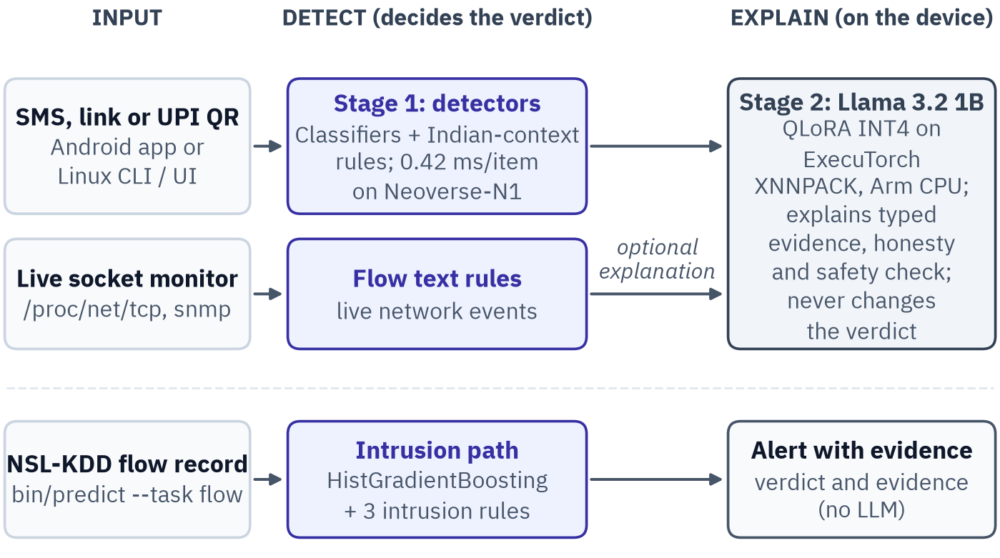

## Abstract {.unnumbered}

Prahari is an offline cybersecurity triage assistant for Indian smartphone and Arm Linux users, built for Problem Statement 3 of the Arm Bharat AI-SoC Challenge 2026–27. Compact classical models and transparent Indian-context mechanism rules classify suspicious SMS and WhatsApp-style messages, phishing URLs and prompt-injection attempts on the device, and network events on Arm Linux. Llama 3.2 1B Instruct, quantized to 4-bit integers (INT4) with quantization-aware LoRA training (QLoRA) and running through ExecuTorch XNNPACK on the Arm CPU, then explains the structured evidence in plain language next to vetted safety steps; when no reply passes deterministic checks, the app shows labelled fixed text instead. On a Samsung Galaxy S23 phone, a warm KYC check takes a median 1.857 s at 32.5 tok/s decode, and the app declares no network permission. On Arm Neoverse-V2, a whole-process profile places 54.17% of sampled CPU time inside Arm KleidiAI kernels. We report every holdout, including an independently authored but repeatedly scored sealed set (n = 184) on which the false-positive rate (FPR) is still 0.300 (30 of 100 genuine messages). Prahari is strictly advisory: inference and storage stay on the device, and content leaves the app only when the user chooses to share a warning or copy a report. Built with Llama.

**Keywords:** on-device AI, scam detection, phishing, Arm, KleidiAI, ExecuTorch, Llama 3.2, India, privacy

## Introduction

Indian smartphone users routinely receive fraudulent messages built around familiar domestic rails: UPI collect requests disguised as refunds, fake KYC or PAN/Aadhaar suspension warnings, electricity-disconnection threats, courier and customs fees, task-recharge scams, and "digital arrest" impersonation of police or regulators. The Ministry of Home Affairs has publicly warned about fake digital arrests and courier impersonation [1]. NCRB recorded 101,928 registered cybercrime cases in 2024, and I4C separately reported more than 6,589,201 financial-fraud complaints totalling over Rs 55,050 crore on the national portal across 2021–2025 [2]. Registered cases and portal complaints are distinct measures and do not quantify Prahari's target user base.

The detection problem is hard because genuine bank debit alerts, OTP notifications, bill reminders and telecom advisories share the same vocabulary ("OTP", "Rs", "UPI", "account", "KYC", "blocked") across English, Devanagari Hindi and Romanised Hinglish. This motivates the design: a keyword filter would be expected to flag legitimate alerts, and a cloud-LLM wrapper would send private banking texts off the device. Following the PS3 brief and mentor guidance [A1], Prahari keeps all inference local on Arm hardware and asks *what the sender wants the recipient to do*, which separates scams from benign informational notices.

\needspace{5\baselineskip}
This report makes four contributions:

1. **A hybrid detect-then-explain pipeline.** Deterministic classifiers and Indian-context mechanism rules decide the verdict; Llama 3.2 1B only explains the structured evidence.
2. **An on-device Arm deployment.** The measured message and link detect-and-explain pipeline runs on a Samsung Galaxy S23 phone and on Arm Linux through ExecuTorch XNNPACK, with profiled execution inside Arm KleidiAI `kai_*` kernels. Call Guard (voice notes) is a Linux preview whose Android prototype is not yet wired into the app, and the live network monitor is Linux-only.
3. **Verified offline operation.** The Android app declares no `INTERNET` permission and was tested in Airplane Mode; on Linux, inference passes with the network namespace cut [A9, A10].
4. **An honest evaluation.** We report the development sets and every holdout with counts and confidence intervals, including an independently authored sealed set that was scored repeatedly during development, together with its remaining false alarms.

Table 1 summarises the headline results and Figure 1 shows them at a glance; Sections 5 and 6 give the full measurements and caveats. Throughout, recall is the share of scams flagged, the false-positive rate (FPR) is the share of genuine messages flagged, and F1 is the harmonic mean of precision and recall. Intervals are 95% Wilson score intervals computed from the stated counts.

| Metric | Result | Setting |
|:------------------------|:----------------------------|:------------------------|
| Warm KYC check, phone | 1.857 s median, 32.5 tok/s | Galaxy S23, n = 2 per pass |
| Linux throughput | 0.98 s/item, 104.6 tok/s | Neoverse-V2, 8 threads |
| KleidiAI share of CPU time | 54.17% | Neoverse-V2, 2 threads, `perf` |
| India v3 held-back split | F1 0.970, FPR 0.000 (0/47) | n = 81 |
| Sealed holdout | F1 0.812, FPR 0.300 (30/100) | n = 184, repeatedly scored |

Table: Key Phase 1 results. Phone timings are the median of two warm KYC checks with the model preloaded; the sealed holdout is independently authored but was scored repeatedly (Section 6.1).

## Related Work

India already has strong anti-scam tools. Among the products in Table 2, none documents, as of 24 Nov 2026, a mode that explains a suspicious message in plain Hindi or English on a phone with no network. Table 2 compares them on four properties; the entries reflect the cited vendor and government pages checked on that date, not hands-on testing.

| Product | Offline | India rails | Explains | Link/QR |
|:------------------------------------------------|:--------|:--------|:--------|:--------|
| Google Messages Scam Detection [3–5] | Partial | No | No | Yes |
| Pixel / Samsung call and message guards [4, 6, 7] | Yes | Partial | No | No |
| Truecaller Fraud Protection [8–10] | Partial | Yes | No | Partial |
| Airtel network spam and link protection [11] | No | Yes | No | Yes |
| Bitdefender Scamio; McAfee; Norton Genie [12–14] | No | No | Partial | Yes |
| Sanchar Saathi Chakshu, 1930, TRAI DLT rules [15, 16] | No | Yes | No | No |
| **Prahari (this work)** | **Yes** | **Yes** | **Yes** | **Partial** |

Table: Documented features of related products. Offline: inference without a network (Partial: some modes send data to the cloud). India rails: Hindi/India support or routing to Indian reporting channels. Explains: plain-language reason for a verdict. Link/QR: link or QR-code checking. "No" means not documented in the cited sources.

{#fig:overview width=6.5in}

The closest products split along the same line. Google Messages runs standard scam detection on-device, but its Enhanced mode sends conversations with unknown senders to cloud Gemini, and Hindi is not among its listed languages. Truecaller filters SMS on-device at scale for India, while its caller ID and spam database are cloud and crowdsourced. In their documented modes, Scamio, McAfee and Norton answer questions about texts, links and QR codes in the cloud and in English; on-device or Hindi support is not established by their pages.

Research points the same way. Saavalainen [17] ran Gemma 3n-E2B-it zero-shot on an Android phone on Finnish SMS: it missed 15 of 41 dangerous messages (63.4% recall) against 2 of 41 for a cloud model (95.1%), and produced more unsupported details. The thesis concludes that small models "appear more suitable as part of a broader detection and explanation pipeline than as standalone phishing detectors". ElZemity et al. [18] distil LLM teachers into Qwen2.5-0.5B and SmolLM2-135M SMS classifiers, reaching 94.31% accuracy and 96.25% recall, but give the user no explanation.

Prahari fills the gap between these lines of work: detectors decide, as in [18], and Llama 3.2 1B only explains, as [17] recommends. Its distinct combination is Indian scam mechanisms in English, Hindi and Hinglish; vetted next steps (Chakshu, 1930, cybercrime.gov.in) for every verdict, plus an on-device explanation that is either checked AI text or clearly labelled fixed text (Section 3.3); and no network at inference. Its main gaps are equally clear. Prahari does not sit in the message or call path, has no link-reputation feed (only rules, including a typosquat list of 56 Indian official domains), and its false-alarm rate on hard benign notices is still high (Section 6.1).

## System Design and Methodology

This section describes the two-stage pipeline, the Android and Linux applications, and the data and protocol used to evaluate them.

### Architecture

Prahari splits each decision into two stages (Figure 2). Stage 1 is a set of compact detectors and transparent rules that decide the verdict and extract typed evidence. Stage 2 is Llama 3.2 1B, run on the device through ExecuTorch, which turns that evidence into a short plain-language explanation.

The language model never decides the verdict and never chooses critical helpline actions. Its output does not set the detector verdict, so a hallucination or a prompt injection hidden in an untrusted message does not change a \vlabel{DANGEROUS} item to \vlabel{NO RISK}; detector and implementation errors remain possible [A2]. Stage 1 is also fast: 0.42 ms per item on Arm Linux, and 5–17 ms warm for text checks on the Galaxy S23 phone (183 ms for a URL; 16–80 ms in a later build).

{#fig:arch width=6.5in}

### Stage 1 detectors and Indian-context rules

Stage 1 combines four small scikit-learn models with a rule layer. The SMS model uses word and character TF-IDF (term frequency–inverse document frequency) features with logistic regression, trained on English SMS corpora. The URL model adds character n-gram TF-IDF to lexical indicators: punycode and homoglyph digit swaps, brand lookalikes on disposable TLDs such as `.top` and `.xyz`, missing HTTPS, IP hosts and excessive subdomains. URLs are never fetched.

The Indian-context model joins character and word n-grams with a 19-dimension mechanism feature vector, so unseen Hindi and Hinglish spellings still activate shared cues. The flow model is a histogram gradient-boosted tree over NSL-KDD's 41 named features, plus three high-precision intrusion signatures (failed-login bursts, malformed fragments, same-source/destination loops) that fire on 0.10% (75/74,112) of normal train and dev records [A4].

The mechanism layer first normalises zero-width characters, full-width Unicode and spaced capitals. It then separates harmful mechanics from benign ones. Harmful mechanics include requests for OTP, PIN, CVV or card details; payment to a personal number, UPI ID, "safe" account or lookalike domain; UPI collect requests; installing a screen-sharing or remote-access APK; digital-arrest coercion; upfront job, loan, customs or prize fees; and sending ID papers to a chat or link. Benign mechanics include completed receipts, OTP notifications, routine bills, official app pointers and protective disclaimers.

Precedence is deliberately asymmetric. A decisive harmful mechanic overrides a protective disclaimer, because scammers routinely write *"no OTP needed, pay Rs 499 fee"*. In the other direction, a contact counts only when an action names it, toll-free numbers are distinguished from personal mobiles, and advisories without a spoofed contact are cleared.

Genuine-looking bank debit alerts that advise blocking the card in the bank app get a cautious \vlabel{uncertain} verdict rather than a scam label. The app shows it as an amber \vlabel{CHECK THIS ALERT} banner (or \vlabel{SUSPICIOUS} when the alert names an unofficial link or private number) with the step *"Didn't make this payment? Call 1930 and block the card or UPI in your bank app"*. Untrusted text is also scanned by a dedicated prompt-injection route and is always framed as quoted data inside the Llama prompt.

### Stage 2 grounded explanation and safety checks

Stage 2 runs Meta's INT4 QLoRA release of Llama 3.2 1B Instruct through ExecuTorch's `TextLLMRunner` on Linux and `LlmModule` on Android [A7]. The prompt supplies the authoritative verdict, a short scam category and a compressed evidence phrase, neutralises live URLs, and asks for a verdict-first sentence followed by one protective step.

Fixed India-specific steps always appear above the AI text. Sanchar Saathi Chakshu is primary for scam messages and links before any loss, 1930 is primary once money has been debited, and cybercrime.gov.in is shown for extortion and sextortion.

The second sentence is grounded. The prompt carries one vetted, advice-led key fact per scam type or benign reading, and Llama writes its own sentence from it instead of filling an empty slot with stock lines [A12]. Deterministic checks then validate the output:

- A generated sentence is dropped if it claims a link, number, device or domain the item lacks, makes an unsupported OTP, payment, app or KYC claim, hedges against a \vlabel{NO RISK} verdict, or is vague, first-person, overclaiming or mixed-script. The vetted fact replaces it.
- \vlabel{NO RISK} openings assert only the absence of elements that are actually absent, and never cite an overruled risk signal.
- Repeated sentences are removed, and generated questions (such as *"Can I help you with something else?"*) are stripped or replaced by the scam type's vetted step.

Each check therefore ends in one of three explanation outcomes, and the app labels which one the user sees. (1) Accepted AI text, marked "AI-written and can be wrong". (2) The detector's fixed text, marked as not written by AI, when every reply fails the checks, Llama runs out of time, or gating skips Llama for a \vlabel{NO RISK} result. (3) A notice that no explanation is available, when the model is missing, fails to load or raises an error; the Linux CLI prints "Explanation unavailable" whenever no reply passes the checks. The verdict and the vetted steps are shown in all three cases.

Hindi mode shows a fixed-text Hindi summary built from the detector result and labelled as not AI-written. The 1B model cannot write usable Hindi, so the Llama explanation stays in English.

### Applications

The Android app is fully offline. It uses a Kotlin UI, Chaquopy 17.2.0 (Python 3.10, NumPy 1.26.2) and the ExecuTorch Android 1.5.1 AAR. It declares no `INTERNET` permission, checked automatically on every build, and disables backup. Messages arrive through the Android share sheet or text selection; the app offers an EN/Hindi toggle, offline text-to-speech over the vetted verdict and steps, quoted evidence with defanged URLs and masked OTPs, opt-in redacted local history (off by default), and an on-device QR photo decoder that needs no camera or storage permission [A7].

Later additions extend coverage to Indian payment and device scams. A UPI QR checker parses `upi://` links offline and flags collect requests, payee mismatches and "scan to receive" lures. A typosquat check flags near copies of 56 Indian official domains and direct `.apk` downloads. *Copy report* drafts a masked, defanged Chakshu report and *Send to family* shares a short warning with no message details. An amber banner appears when AnyDesk, TeamViewer, AirDroid or RustDesk is installed during a bank, UPI or OTP scam. A sender check raises a bank-style SMS from a personal mobile number to at least \vlabel{SUSPICIOUS}. Call Guard, a Linux preview behind a flag, transcribes a shared voice note with Arm's INT8 Whisper Tiny on the CPU and applies digital-arrest call rules; its Android prototype compiles with the app but has no entry point in the UI and has not run on a phone. The newest Android features (report card and family share, screen-sharing banner, sender check, the app side of the typosquat check) and earlier interface additions (OTP masking, official-channel verdicts, opt-in history, font scale 2.0) were checked on an Android 14 emulator, not on the phone, so they carry no Arm timings [A18].

On Linux, a CLI runs an 8-item demo benchmark and a loopback-only web UI serves the same pipeline. A rootless live monitor samples `/proc/net/tcp`, `/proc/net/tcp6` and `/proc/net/snmp` every 0.5 s, without root or packet capture, to flag port scans, repeated login-port connects, half-open floods, periodic beacons and failed-connect bursts; it feeds these descriptions to the flow rules and an optional Llama explanation. The monitor is Linux-only (Android 10+ restricts `/proc/net`) and is separate from the NSL-KDD replay path [A11].

### Datasets and evaluation protocol

Table 3 summarises the data. Public sets are split with grouping to prevent leakage: SMS by normalised text, URLs by domain. Their eval splits, and the project's Indian eval set, were reused during development, so their scores are optimistic.

| Dataset | Licence | Split (n) | Use |
|:----------------------------------|:--------------|:---------------------------|:--------------|
| UCI SMS Spam [19] + Mendeley SMS Phishing [20] | CC BY 4.0 | 4,127 / 607 / 1,162 | SMS model |
| PhiUSIIL URLs [21] | CC BY 4.0 | 40,000 / 4,000 / 7,997 | URL model |
| NSL-KDD [22] | UNB, with citation | 113,273 / 12,700 / 22,544 | Flow model (shifted test) |
| Indian and Hinglish seeds [23] | Apache-2.0, CC BY 4.0 | 136 train rows | Indian-context model |
| Project Indian set (visible) | Original | 256 / 64 / 320 | Indian-context model |
| India v2, v3, v4 sets | Original | v2 400; v3 159 + 81; v4 161 + 79 | Tuning + held-back test |
| Blind validation set | CC0 | 240 (150 genuine, 90 scam) | False-alarm check |
| Sealed holdout | Original | 184 (155 SMS + 29 injection) | Repeatedly scored holdout |

Table: Datasets, licences and splits (train / dev / eval unless noted; "159 + 81" is tuning + held-back). Table 7 reports the eval splits of the first three rows and of the visible Indian set, the held-back parts of v3 and v4, and the last two rows.

The Indian test sets are synthetic, and none of them contains real user messages, so the results below do not establish field performance. Each was written outside the detector work:

- **India v3** was authored blind; its 81-message held-back split has 47 genuine messages and 34 scams.
- **India v4** was written by an AI model (Gemini): 240 messages (140 genuine, 100 scam; 60% English, 25% Hinglish, 15% Hindi), split by label and category into 161 tuning and 79 held-back messages (47 genuine, 32 scam) [A12].
- **The blind validation set** was written by an AI coding agent with no access to the repository or any dataset, working from public RBI, NPCI, UIDAI and TRAI format guidance: 119 English, 60 Hindi and 61 Hinglish messages. Its scams barely test contactless fraud (84 of 90 carry a link or mobile number) [A12].
- **The sealed holdout** was authored independently of the detector developers by an AI model (Gemini). It holds 84 malicious and 100 benign items: 155 SMS-route (68 scam, 87 genuine) and 29 prompt-injection-route (16, 13) [A8].

Author independence is not the same as independence from model selection. The sealed set was scored at several detector checkpoints and its false alarms were read, so it is an *independently authored, repeatedly scored holdout*, not an untouched estimate of generalization. India v2 was aggregate-only adaptive validation, and the v3 split was also used as a check during later fixes.

All headline detection numbers use conservative metrics: an \vlabel{uncertain} verdict counts as an error on both classes, so a scam left \vlabel{uncertain} is a miss and a genuine message left \vlabel{uncertain} is a false alarm. Coverage (the share of decided verdicts) is therefore folded into recall and FPR rather than reported separately. An earlier evaluation gave half credit to \vlabel{uncertain} and is superseded [A3].

## Optimization on Arm

Prahari targets an interactive response of about 1–2 s and a bounded memory footprint on CPU-only Arm SoCs. Measured against that target, a warm KYC check on the Galaxy S23 took 1.20 s on the first build and 1.857 s on the final build, but 2.611 s in the hotter gated pass, and the six-item p90 reached 3.977–5.252 s on a small synthetic mix (Section 5.1). On Neoverse-V2 at 8 threads, warm items took 0.534 s and the all-item mean, which includes the cold first item, 0.980 s (Section 5.2).

Table 4 lists the six engineering choices behind these numbers. For each it separates the design rationale from what was actually measured, and names the ablation that was not run. None of the techniques was isolated in a controlled on/off experiment on the phone.

| Technique | Rationale | Measured effect | Not measured |
|:------------------|:------------------|:------------------------------|:------------------|
| Detector-first cascade | Keep the LLM off the verdict path | Detectors 0.42 ms/item (Linux); 5–17 ms warm, 183 ms URL (S23) | End-to-end gain over an LLM classifier |
| QLoRA INT4 weights (group-32, 8-bit dynamic activations) | Fit phone memory; faster decode | 19.9 vs 12–13.5 tok/s decode over SpinQuant INT4 (N1, mixed host load); 1.18 GB `.pte` | FP16 baseline (size only computed) |
| KleidiAI kernels via XNNPACK | Use `i8mm` and `dotprod` | 54.17% of CPU samples in `kai_*` (V2, 2 threads) | On/off speedup; dispatch on the phone |
| Compact prompt, greedy 40-token cap | Cut prefill and decode work | Median prompt 222 → 130 tokens, 5.39 → 3.67 s/item (N1, mixed host load) | Controlled re-run on V2 or the phone |
| Model preload and reuse | Pay load and packing once | Cold first item 4.02–4.06 s vs warm 1.04–1.74 s (V2, 2 threads) | — |
| Portable detector export | Avoid cross-version pickles | Parity with reference outputs on every build; 5–17 ms warm (S23) | — |

Table: Optimization techniques: rationale, measured effect and missing ablations. N1 comparisons ran under mixed host load and changed prompt content as well as length, so they are indicative only.

On Neoverse-N1 the QLoRA INT4 export also led SpinQuant on prefill (~83.1 against ~58–63 tok/s), so it was kept [A2, A4]. The prompt holds the verdict directive, a compressed evidence phrase and at most 320 input characters with links defanged; the six demo items used 109–128 prompt tokens (median 123) and generated 25–39 (median 28). Android's Python runtime offers only scikit-learn 1.3.2 (training uses 1.9.1), hence the JSON/NumPy export [A7, A13].

## Hardware Utilization and Performance

We measured Prahari on three Arm targets with separate workloads and measurement boundaries: a Samsung Galaxy S23 phone, an Armv9 Neoverse-V2 Linux server (8 vCPUs) and a 2-vCPU Neoverse-N1 evaluation VM [A8, A9, A10].

### Galaxy S23 phone

The phone is a Samsung Galaxy S23 (SM-S911B, Snapdragon 8 Gen 2 / SM8550, Android 14, `arm64-v8a`; CPU flags include `asimddp`, `i8mm` and `bf16`). The APK used ExecuTorch Android with XNNPACK, declared no `INTERNET` permission, and the model and tokenizer matched their pinned hashes on the device. Table 5 gives the final measured build, run in two passes over six built-in samples (a cold KYC check, two warm KYC checks, a bill reminder, an official link and a lookalike link): first with Llama on every item, then with flagged-only gating. The model was preloaded before each pass, and the totals exclude that preload. All phone timings are app-reported telemetry, and temperatures are battery readings [A17].

| Check (final build) | TTFT | Decode | Total |
|:----------------------------------------------|----------:|----------:|---------------:|
| Warm KYC scam SMS, all-items pass (median, n = 2) | 879 ms | 32.5 tok/s | 1.857 s |
| Warm KYC scam SMS, gated pass (median, n = 2) | 1,275 ms | 23.9 tok/s | 2.611 s |
| Six-item median / p90, all-items pass | — | — | 1.984 / 3.977 s |
| Six-item median / p90, gated pass | — | — | 2.611 / 5.252 s |
| Bill / official link, gated (Llama skipped) | — | — | 0.186 / 0.312 s |
| Lookalike link (detector-text fallback) | — | — | 5.001 / 6.399 s |

Table: Galaxy S23 app telemetry, final build. The model was preloaded before each pass; warm checks exclude preload. The six-item p90 is over a synthetic mix that includes a cold check and a fallback, not a production tail estimate. TTFT is time to first token; prefill was 165.0 tok/s (all-items) and 113.8 tok/s (gated). "—": not reported.

The first on-phone run (23 November) was faster: 6 ms detector, 510 ms TTFT, 43.4 tok/s decode and 1.20 s per warm KYC check, and 1.42 s for the same check in Airplane Mode; an intermediate build measured 2.90 s and ~22 tok/s. In the latest run the battery temperature rose from 41.7 °C to 45.1 °C. The gated pass always ran second and hotter, so its slower KYC times may be thermal, but the cause was not tested; they do not measure the effect of gating, and throttling itself was not measured. For the lookalike link, Llama ran but no reply passed validation, so the app showed the detector's fixed text, labelled as not AI-written [A9, A14, A17].

### Neoverse-V2 and Neoverse-N1

Table 6 shows thread scaling on Neoverse-V2 (Debian 12, 8 vCPUs, 15 GiB RAM, ExecuTorch 1.6.0). Each setting ran three processes × six items; values are means of the three run means [A10]. The 2-vCPU Neoverse-N1 evaluation baseline, on a 28-item suite, reached 83.1 tok/s prefill, 19.9 tok/s decode and 3.84 s per item [A8].

Going from 1 to 8 threads raised decode 4.07× and prefill 6.19× on Neoverse-V2, bringing mean per-item turnaround below 1 s. At 2 threads, V2 delivered 2.57× the prefill and 2.33× the decode of the 2-vCPU N1 VM. The two machines ran under different conditions, so this ratio is descriptive and does not separate `i8mm`/KleidiAI from core design or memory bandwidth. Figure 3 plots the V2 thread scaling next to the per-target throughput.

\needspace{10\baselineskip}

| Neoverse-V2 threads | TTFT | Prefill | Decode | Item wall |
|:------------------------|-----------:|-------------:|-------------:|----------:|
| 1 | 1,465.5 ms | 109.26 tok/s | 25.69 tok/s | 2.792 s |
| 2 | 922.0 ms | 210.58 tok/s | 46.69 tok/s | 1.728 s |
| 4 | 907.7 ms | 378.79 tok/s | 75.89 tok/s | 1.470 s |
| 8 | 526.8 ms | 676.80 tok/s | 104.58 tok/s | 0.980 s |
| 8, warm items only | 159.3 ms | 751.17 tok/s | 104.31 tok/s | 0.534 s |

Table: Llama 3.2 1B INT4 on Neoverse-V2 (means over 3 runs × 6 items; the first item of each run is cold). The 4-thread TTFT varied widely (± 373.0 ms).

{#fig:arm-perf width=6.5in}

### Arm kernel evidence

The KleidiAI kernels are present in the ExecuTorch XNNPACK build (517 `kai_` symbols) [A5], and Prahari's INT4 matrix multiplications are observed executing in them on Neoverse-V2. A whole-process `perf` profile of one 2-thread run, covering startup, model load and six inferences (~2,222 samples, 0 lost), put 54.17% of sampled CPU time in `kai_*` kernels: 23.27% in the `i8mm` prefill matmul, 20.57% in the `dotprod` decode matmul and 10.33% in packing and helper kernels [A10]. This is a CPU-time share, not a fraction of inference wall time. No supported runtime switch was found to disable KleidiAI, so an on/off speedup was not measured. Dispatch to these kernels on the phone has not been shown directly.

### Memory

On the Galaxy S23, `dumpsys meminfo` after a KYC check reported 1,744,842 KiB (1,704 MiB) total PSS and 1,867,396 KiB (1,824 MiB) RSS. PSS (proportional set size) splits shared pages among the processes that map them; RSS (resident set size) counts them in full, so RSS is the larger. The measured native heap was 1,566,056 KiB (1,529 MiB), 89.8% of PSS computed from the KiB values (rounded MiB give 89.7%). Model weights, the XNNPACK workspace and the KV cache are the expected contributors to that heap; `dumpsys` does not break it down, so their split was not measured. Figure 4 shows the measured categories.

{#fig:memory width=6.5in}

Peak sampled memory in the latest run was 1,795.3 MiB PSS / 1,907.9 MiB RSS; memory was polled every 500 ms, so shorter spikes may be missed. On disk, the APK plus model and tokenizer take 1.147 GiB. Runner RSS on Neoverse-V2 was 2,392.1 MiB after generation, and the N1 VM peaked at 2.05 GB of cgroup memory. This footprint leaves little headroom on 4–6 GB phones, and the eight checks of the first phone session are too few to show long-run stability [A9, A13].

\needspace{9\baselineskip}

## Results

We report detection first, then explanation quality and functional verification.

### Detection performance

Table 7 reports the detector on every benchmark we hold, with conservative scoring (Section 3.5). The first four rows are eval splits reused during development and are optimistic; the last four were kept out of tuning to different degrees [A8, A12].

The holdouts differ mainly in how often genuine messages raise false alarms. A contact gate lets a text-model score flag a message only when the reader is given something to act on (a non-official link, number or chat handle, a request, a payment order or a threat). With it, the v3 split went from 6 to zero observed false alarms (0/47), and with later negation fixes the blind validation set fell from 31 to 16 of 150, both with recall unchanged. Zero observed false alarms on 47 genuine messages is still compatible with an FPR of up to 0.076.

| Set | n | Recall | F1 | FPR (false alarms / genuine; 95% CI) |
|:----------------------------------|------:|-------:|-------:|:-----------------------------|
| SMS eval split | 1,162 | — | 0.925 | — |
| URL eval split | 7,997 | 0.988 | 0.994 | 0.000 (0/4,000; 0.000–0.001) |
| Indian eval split (visible set) | 320 | — | 0.969 | 0.031 (5/160; 0.013–0.071) |
| NSL-KDD flow replay (`KDDTest+`) | 22,544 | 0.757 | 0.850 | 0.030 (294/9,711; 0.027–0.034) |
| India v3 held-back split^a^ | 81 | 0.941 | 0.970 | 0.000 (0/47; 0.000–0.076) |
| Blind validation set^b^ | 240 | 1.000 | 0.918 | 0.107 (16/150; 0.067–0.166) |
| India v4 held-back split^c^ | 79 | 0.969 | 0.805 | 0.298 (14/47; 0.187–0.440) |
| Sealed holdout^d^ | 184 | 0.929 | 0.812 | 0.300 (30/100; 0.219–0.396) |

Table: Detection results with conservative scoring. Development exposure: ^a^ used as a check during later fixes; ^b^ false alarms read after the first scoring, never tuned on; ^c^ never seen by the fixing work, scored once per candidate; ^d^ scored at several checkpoints (Table 8) and its false alarms read. "—": not recorded. The Indian count is FPR × 160 genuine items. The 95% intervals reflect binomial count uncertainty only; they do not account for adaptive selection or represent field-population uncertainty.

On the v4 split, which the fixing work never saw, false alarms remain on advisories, bank and OTP alerts, delivery notices and links to small-business sites. The sealed holdout is harder still: every link in it uses a `.example` placeholder, which the gate treats as a contact and the domain rules call risky. As a result 28 of 87 genuine SMS (FPR 0.322; 95% CI 0.233–0.426) are still flagged, mostly advisories carrying such a link, family chats warning about scams, and doorstep or self-check messages [A12, A15].

Figure 5 plots conservative F1 and FPR for every benchmark in Table 7, so the gap between the development sets and the held-back sets is visible at once.

{#fig:eval width=6.5in}

Table 8 shows how the sealed-holdout numbers moved as components were added; injection-route FPR stayed at 0.154 (2 of 13) after the rules-and-text-model freeze [A8, A15].

| Configuration | Recall | FPR (false alarms / 100) | F1 |
|:------------------------------------------------|-------:|-------:|-------:|
| Initial baseline | 0.738 | 0.290 (29) | 0.709 |
| Rules + text model freeze | 0.917 | 0.310 (31) | 0.802 |
| After further recall tuning | 0.929 | 0.370 (37) | 0.784 |
| Current detector (contact gate, negation handling) | 0.929 | 0.300 (30) | 0.812 |

Table: Sealed holdout (n = 184; 100 genuine) at successive checkpoints, each a further use of the same set.

### Explanation quality

We audited generated English explanations blind, rating each as correct, weak or wrong (Table 9). The three fresh-item audits each used 20 new items written by an AI agent that saw no project code or data. An LLM judge (OpenAI GPT-6.1 Terra) saw each item with the before and after outputs as an unlabelled, shuffled A/B pair and applied a fixed rubric; for Hindi it rated correctness and accessibility for a Hindi-only older reader (0–10). "Before" is the build without grounded facts and the Hindi summary; "after" adds them, with the same detector [A12]. The initial audit used a different judge (Google Gemini 4 Neon) and items, and recorded only one side. No human audit was done on the fresh items.

| Audit (20 items each) | English before | English after | Hindi correct | Hindi access |
|:-----------------------------------|--------------:|--------------:|-----------------:|--------------:|
| Initial audit (Gemini judge) | — | 5 / 8 / 7 | — | — |
| Fresh-item audit 1 | 11 / 6 / 3 | 8 / 7 / 5 | 0/20/0 → 9/7/4 | 4.50 → 6.30 |
| Fresh-item audit 2 | 6 / 9 / 5 | 11 / 4 / 5 | 0/20/0 → 5/9/6 | 3.50 → 5.45 |
| Fresh-item audit 3 | 5 / 12 / 3 | 10 / 5 / 5 | 0/18/2 → 7/6/7 | 4.05 → 6.40 |
| Audit 3 items, later build | 8 / 2 / 10 | 9 / 4 / 7 | — | — |

Table: Blind explanation audits: correct / weak / wrong counts; Hindi access is a 0–10 score; arrows show before → after.

Grounding did not reduce wrong English explanations (3, 5, 3 → 5, 5, 5); most remaining errors repeat a wrong detector evidence phrase. Hindi improved from no correct summaries to 5–9 of 20, but 4–7 per audit were still wrong, mostly by translating that same evidence.

In the last row, a wording fix moved the regenerated audit 3 items from 8/2/10 to 9/4/7 (false input claims 9 → 6), but the gain came from `.example`-domain wording that real SMS never contain, so it overstates real-world improvement [A15].

### Verification

A regression suite of 1,355 detector and LLM-safety tests passes on the current detector, including 39 tests for the live monitor and about 120 Call Guard call-script cases, with Android parity and manifest-permission checks in CI [A11, A12]. The rootless Linux connection monitor classified a 150-port loopback scan as \vlabel{DANGEROUS}, a quiet window as benign, and a closed-port scan as \vlabel{SUSPICIOUS} from kernel counter jumps.

## Responsible AI, Limitations and Future Work

### Responsible AI and privacy

Prahari is private by construction. The Android APK requests no `INTERNET` permission, disables backup (`allowBackup` is false), sends no telemetry and runs every model on the phone, so messages, OTPs and bank alerts are not sent anywhere unless the user chooses to share a warning or copy a report; history is off by default and redacted when enabled. The design is advisory: vetted English and Hindi steps and the official reporting channels (Sanchar Saathi Chakshu, the 1930 helpline and cybercrime.gov.in) always appear above the AI card, which warns that it "can be wrong", and a benign result reads "\vlabel{NO RISK FOUND} — still verify", never "safe". The entrant used AI-assisted tools for mockups, Hindi copy review, coding and code review, and checked every architecture choice, measurement and safety text personally [A7].

### Limitations

- **False alarms on genuine notices.** The sealed-holdout FPR is 0.300 overall (SMS + injection, 30/100) and 0.322 on SMS (28/87), mostly on advisories and family warnings, so automatic background SMS scanning stays disabled until it falls well below that level on unseen data.
- **Synthetic test data.** Every Indian test set is synthetic and AI- or blind-authored; none contains real user messages, so field performance is not established.
- **Phone performance is not yet stable.** Latency and throughput on the Galaxy S23 differed between builds and runs (Table 5); no run started from a cool phone, samples are small, and the cause of the differences is not established. KleidiAI kernels were observed executing, but no on/off speedup was measured.
- **Memory headroom.** Peak memory of about 1.7–1.9 GiB (Section 5.4) leaves little room on 4–6 GB phones; a mid-range phone has not been tested.
- **Hybrid scams and explanation quality.** A few adversarial scams that mix an official app with an unofficial link still pass the rules, the blind audits still rate some English explanations wrong, the AI prose is English only (the Hindi summary is fixed text), and several app features (report card, remote-app banner, sender check, APK-link warning) were checked only on the emulator. TalkBack is untested.
- **Network scope.** The live connection monitor is Linux-only, samples sockets rather than capturing packets, and is separate from the NSL-KDD replay classifier; Call Guard has no Android entry point yet.

### Future work

- **Wider, safer coverage:** a pause-and-explain link interstitial, screenshot OCR, opt-in notification scanning once false alarms are low enough, and Call Guard on the phone with a Hindi-capable speech model.
- **Fresher threat knowledge offline:** a refreshed local snapshot of a phishing feed such as OpenPhish or PhishTank (within licence terms) and signed offline rule-pack updates.
- **Faster, leaner Arm execution:** SME2 on newer Arm CPUs and phone NPUs; a smaller KV cache (2048 → 512 context) targeting under 1.35 GB PSS; and a cool-start S23 re-measurement with longer samples.
- **More languages and real users:** Marathi, Tamil, Telugu and Bengali with consented, licensed real messages and a fresh single-shot holdout, and comprehension tests with elderly users (200% font, TalkBack).

## Conclusion

Prahari shows that useful scam triage can run entirely on an Arm phone: deterministic detectors and Indian-context rules decide, Llama 3.2 1B only explains, and the measured message and link pipeline runs offline on a Samsung Galaxy S23 phone and on Arm Linux through ExecuTorch XNNPACK.

On the phone, a warm KYC check takes a median 1.857 s (two checks) with no network permission. On Neoverse-V2, the 8-thread runner averages 0.980 s per item. Separately, a whole-process profile of a 2-thread run put 54.17% of sampled CPU time in KleidiAI kernels. On the v3 held-back split the detector reaches F1 0.970 with zero observed false alarms (0/47; 95% CI 0.000–0.076).

The open limits are equally concrete: an FPR of 0.300 (30/100) on the independently authored, repeatedly scored sealed holdout; synthetic test data; small and thermally uncontrolled phone samples; no measured KleidiAI on/off speedup; about 1.7–1.9 GiB of memory; and English explanations of which the blind audits still rate 5 to 7 in 20 wrong. Section 7 lists the planned next steps for each.

## References {.unnumbered}

\RefsBegin

External sources are numbered in order of first citation. Project evidence is cited as [A1]–[A18] and listed in Appendix A.

**[1]** Press Information Bureau, Government of India (2024). *Ministry of Home Affairs advisory on fake "digital arrest" and courier impersonation*. <https://www.pib.gov.in/PressReleasePage.aspx?PRID=2077948>

**[2]** Press Information Bureau, Government of India (2026). *I4C financial-fraud complaint figures, 2021–2025*. <https://www.pib.gov.in/PressReleasePage.aspx?PRID=2287039>

**[3]** Google. *New Android scam protections*. Google blog. <https://blog.google/security/new-android-scam-protections/>

**[4]** Google. *Staying one step ahead: strengthening Android's lead in scam protection*. Google blog. <https://blog.google/security/staying-one-step-ahead-strengthening-androids-lead-in-scam-protection/>

**[5]** Techzei. *Google Messages enhanced scam detection and India availability*. <https://techzei.com/google-messages-enhanced-scam-detection-india/>

**[6]** Neoteo. *Samsung names Japan, Canada and India for Scam Detection*. <https://www.neoteo.com/en/samsung-names-japan-canada-and-india-for-scam-detection>

**[7]** C&K Lab. *Galaxy spam/smishing block settings*. <https://candklab.com/en/blog/galaxy-spam-smishing-block-settings/>

**[8]** Truecaller. *Fraud Protection*. Press release. <https://corporate.truecaller.com/newsroom/press-release/28923657E2813595>

**[9]** Truecaller. *Protect yourself from SMS scams with Truecaller's fraud protection*. Truecaller blog. <https://www.truecaller.com/blog/features/protect-yourself-from-sms-scams-with-truecallers-fraud>

**[10]** Truecaller. *Premium Terms of Service*. <https://www.truecaller.com/premium-terms-of-service>

**[11]** GSMA. *Airtel spam detection solution*. GSMA scams study. <https://www.gsma.com/solutions-and-impact/technologies/security/scams/gsma_study/airtel-spam-detection-solution/>

**[12]** Bitdefender. *Scam Protection / Scamio (India)*. <https://www.bitdefender.com/en-in/consumer/scam-protection>

**[13]** McAfee. *Scam Detector*. <https://www.mcafee.com/en-us/scam-detector/>

**[14]** Norton. *AI scam protection (Norton Genie)*. <https://in.norton.com/feature/ai-scam-protection>

**[15]** Department of Telecommunications. *Sanchar Saathi — Chakshu (report suspected fraud communication)*. <https://sancharsaathi.gov.in/sfc/>

**[16]** Telecom Regulatory Authority of India (2025). *Direction of 19 November 2025* (DLT headers and 1600-series numbers for BFSI calls). <https://www.trai.gov.in/sites/default/files/2025-11/Direction_19112025.pdf>

**[17]** Saavalainen (2026). *On-Device Phishing Explanation Generation Using Small Language Models*. Thesis, University of Helsinki. <https://hdl.handle.net/10138/638168>

**[18]** ElZemity et al. (2026). *Agentic Knowledge Distillation: Autonomous Training of Small Language Models for SMS Threat Detection*. arXiv:2602.10869. <https://arxiv.org/abs/2602.10869>

**[19]** Almeida, T. A., et al. (2011). *SMS Spam Collection*. UCI Machine Learning Repository, CC BY 4.0. <https://archive.ics.uci.edu/dataset/228/sms+spam+collection>

**[20]** Mishra, S., and Soni, D. (2022). *SMS Phishing Dataset*. Mendeley Data, CC BY 4.0. <https://data.mendeley.com/datasets/f45bkkt8pr>

**[21]** Prasad, A., and Chandra, S. (2024). *PhiUSIIL Phishing URL Dataset*. UCI Machine Learning Repository, CC BY 4.0. <https://archive.ics.uci.edu/dataset/967>

**[22]** Tavallaee, M., et al. (2009). *NSL-KDD dataset*. Canadian Institute for Cybersecurity, University of New Brunswick; redistribution permitted with citation. <https://www.unb.ca/cic/datasets/nsl.html>

**[23]** karanverma19. *Indian Multilingual Scam Message Dataset*. Hugging Face, Apache-2.0. <https://huggingface.co/datasets/karanverma19/Indian_Multilingual_Scam_Message_Dataset>; bolewara. *Hinglish scam text dataset*. Hugging Face, CC BY 4.0. <https://huggingface.co/datasets/bolewara/hinglish-scam-text-dataset>

**[24]** Meta. *Llama 3.2 Community License* and *Acceptable Use Policy*. <https://www.llama.com/llama3_2/license/>; <https://www.llama.com/llama3_2/use-policy/>. Weights are obtained separately by users; Prahari's own code is MIT-licensed, and framework licences (ExecuTorch/PyTorch/scikit-learn BSD-3-Clause, Arm KleidiAI Apache-2.0, Chaquopy MIT) apply to their components.

\RefsEnd

\needspace{6\baselineskip}\vspace{6pt}

## Appendix A: Artifact and Provenance Index {.unnumbered}

Table 10 lists the evidence behind each A-numbered citation; paths are relative to the repository root.

| Label | Evidence | Repository path |
|:------|:------------------------------------------|:------------------------------------------|
| A1 | Official challenge brief (PS3) and IIT Delhi PS3 mentoring guidance | \path{docs/challenge-brief.md} |
| A2 | Detector, rules and app server | \path{candidates/BEST/} (\path{REPORT.md}, \path{DATA.md}, \path{app/server.py}, \path{triage/*.py}) |
| A3 | Historical evaluation with half credit for uncertain verdicts, superseded by conservative scoring | \path{research/evals/20261111-075405-best-confirm/} |
| A4 | Research log, leave-one-category-out check and data preparation | \path{research/LOG.md}, \path{research/REPORT.md}, \path{research/stress/loco.py}, \path{eval/prep_data.py} |
| A5 | ExecuTorch 1.6.0 XNNPACK `kai_` symbol inspection on Arm Linux (517 symbols) | \path{docs/phase1/EVIDENCE.md} |
| A6 | Dataset sources, attributions and licences | \path{candidates/BEST/DATA.md} |
| A7 | Android app, CI manifest and permission audits, emulator screenshots | \path{android/}, \path{.github/workflows/android.yml}, \path{docs/phase1/EVIDENCE.md} |
| A8 | Neoverse-N1 evaluations, sealed-holdout scores with counts, initial 20-item explanation audit | \path{docs/phase1/evidence/sealed-holdout/scores.json}, \path{docs/phase1/EVIDENCE.md} |
| A9 | Galaxy S23 first run (23 Nov 2026): device properties, hash checks, Airplane Mode checks, `dumpsys meminfo` | \path{docs/phase1/evidence/galaxy-s23/}, \path{docs/phase1/img/s23-*.png} |
| A10 | Neoverse-V2 benchmark (23 Nov 2026): `perf` KleidiAI profile, thread scaling, `unshare -n` offline proof | \path{docs/phase1/evidence/neoverse-v2/} |
| A11 | Live Linux connection monitor and its 39 tests; explanation honesty fixes, India v3 held-back results and Android UX update (23 Nov 2026) | \path{candidates/BEST/triage/live.py}, \path{candidates/BEST/bin/monitor}, \path{candidates/BEST/tests/test_live.py}, \path{docs/phase1/EVIDENCE.md} |
| A12 | SMS false-alarm fix and blind validation set; Call Guard preview; grounded explanations, Hindi summary and audits; v4 set; UPI QR checker and emulator captures (24 Nov 2026) | \path{research/fpfix/}, \path{docs/call-guard.md}, \path{research/explain-audit.md}, \path{research/v4-heldout/RESULTS.md}, \path{research/app-r3-verify/} |
| A13 | Performance methodology, optimisations and harness (16 harness tests) | \path{docs/perf/}, \path{docs/perf/evidence/}, \path{bench/perf/} |
| A14 | Galaxy S23 final run (24 Nov 2026): per-check results, memory, battery, hashes, demo clips | \path{docs/perf/s23-final-20261124.md}, \path{evidence/galaxy-s23-20261124/} |
| A15 | Validation gate and explanation re-judgement; report card, remote-access app banner, APK-link check | \path{bin/validate}, \path{docs/validation-gate.md}, \path{android/python/report_card.py}, \path{android/app/src/main/java/in/prahari/app/RemoteApps.kt}, \path{docs/typosquat.md} |
| A16 | Sender check and lookalike-link statistics | \path{docs/sender-check.md}, \path{candidates/BEST/triage/sender.py}, \path{evidence/galaxy-s23-20261124/} |
| A17 | Galaxy S23 gating run on the release APK | \path{docs/perf/s23-gating-20261124.md}, \path{docs/perf/evidence/galaxy-s23-gating-20261124/retry/} |
| A18 | Emulator feature check and two failed S23 sessions on 25 Nov 2026 (same APK as A17) | \path{evidence/android-emulator-20261125/summary.md}, \path{evidence/galaxy-s23-20261125/} |

Table: Project evidence index.

## Appendix B: Reproducibility Card {.unnumbered}

The steps below rebuild the Linux detector, its explanations and the validation gate from the public repository on an aarch64 machine. Table 11 then pins the released artifacts and the detector checkpoints behind every reported result.

1. **Install.** With Python 3.12: `python3.12 -m venv .venv`, `. .venv/bin/activate`, `pip install -r candidates/BEST/requirements.txt` and `pip install 'huggingface_hub[cli]'`.
2. **Fetch the model.** Accept the Llama 3.2 licence [24] on the model page, then run `hf download executorch-community/Llama-3.2-1B-Instruct-QLORA_INT4_EO8-ET --local-dir "$PWD/.venv/models/qlora"`. Check both files against Table 11 with `sha256sum`, and point a local model registry at them as the repository README shows. ExecuTorch 1.6.0 runs Linux inference.
3. **Validate.** `bin/validate` scores the committed sets and runs the test suites; add `--baseline BEFORE.json` to fail on any recall drop or FPR rise. Sets that are not in the repository are reported as not scored; `--sealed` scores the sealed set, once per frozen candidate.
4. **Run the demo.** `candidates/BEST/bin/app --selftest`, then `candidates/BEST/bin/app --demo --out .venv/demo.json` (8 items: SMS, URL, UPI, flow, injection).

\needspace{24\baselineskip}

| Item | Value |
|:----------------------|:--------------------------------------------------------------|
| Repository | <https://github.com/rabesss/prahari> |
| Android APK release | <https://github.com/rabesss/prahari/releases/tag/phase1-apk-5b59ee2>, built from commit \path{5b59ee2fcaaa2b6153f9a302abb76a1aac5dd317} |
| APK SHA-256 | \path{88f6a53285c04ef8e0fb7766b05da716dbdc22a4b11112e731b70165e3d07862} |
| Model SHA-256 | \path{ab7b7ebf97421c7770ad97d4abfdf8650a7d9f9dc1ce9a0c4663d49f7b7a08ac} (file \path{Llama-3.2-1B-Instruct-QLORA_INT4_EO8.pte}) |
| Tokenizer SHA-256 | \path{82e9d31979e92ab929cd544440f129d9ecd797b69e327f80f17e1c50d5551b55} (file \path{tokenizer.model}) |
| Current detector checkpoint | Commit \path{75993f19c590144d2369fcfb70d430429daa7990}: Table 7 held-back, blind and sealed rows and the last row of Table 8 (\path{docs/validation-gate.md}) |
| Earlier checkpoints, Table 8 | Rows 1–3 are the first, second and fourth checkpoint entries (initial baseline; rules + text model freeze; commit 7368067) in \path{docs/phase1/evidence/sealed-holdout/scores.json} |
| Reused eval rows, Table 7 | SMS and Indian eval splits: the false-alarm reduction entry in \path{docs/phase1/EVIDENCE.md}; URL: the typosquat-check gate run in the same file; flow: \path{candidates/BEST/REPORT.md} |
| Data not in the repository | v3 and v4 held-back splits and the sealed holdout (hashes pinned in \path{eval/validate.py}); their rows in Tables 7 and 8 cannot be re-run from the repository alone |

Table: Reproducibility card.
